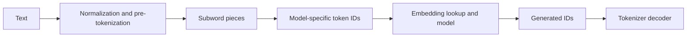

# Tokenization
TL;DR: Tokenization converts text into the discrete IDs a language model was trained to predict, so its vocabulary and normalization rules affect both model compatibility and sequence cost.

## Prerequisites

Know that a language model consumes a sequence of IDs and predicts a distribution over the next ID. A tokenizer is a paired vocabulary and encoding/decoding procedure; it is part of the model interface, not a replaceable text-cleaning detail.

## Learning Outcomes

- Trace a string through normalization, segmentation, token IDs, and decoding.
- Explain why subword vocabularies trade sequence length against vocabulary size.
- Measure token fertility and token count for a representative language or domain sample.
- Diagnose a tokenizer mismatch, unknown-token, or context-budget problem from tokenized examples.

## Core Intuition

Think of tokenization as choosing the size of the pieces in a model's alphabet. A character vocabulary has few symbols but writes every message as a long sequence. A word vocabulary gives short sequences for familiar words but cannot cheaply represent every name, typo, new product, or inflection. Subword tokenization sits between these extremes: frequent strings become single pieces, while unfamiliar strings can be composed from smaller pieces. The pieces are statistical units, not guaranteed words or meaningful morphemes.

For example, one tokenizer may encode `unhappiness` as one token, while another may use `un`, `happi`, `ness`. Either can reconstruct the text if its encoding is lossless, but the model receives different sequence lengths and different IDs. The token ID itself has no portable meaning: ID 417 in one vocabulary need not correspond to the same text in another. The checkpoint and tokenizer therefore travel together.

## How It Works

A typical text path applies model-specific normalization and pre-tokenization, then maps pieces to integer IDs. Some tokenizers operate on Unicode text; byte-level schemes can represent arbitrary input bytes and avoid an unknown token for unseen characters. Boundary markers or special IDs may represent beginning/end of sequence, padding, or chat roles. Their spellings are not necessarily ordinary text: implementations often recognize them as reserved IDs before ordinary segmentation.

Byte-pair encoding (BPE) starts with small units and repeatedly merges frequent adjacent pairs in a training corpus until a vocabulary budget is reached. At inference, the learned merge ranks are applied deterministically. WordPiece also builds subword units but uses a different training objective and continuation-marker convention. Unigram tokenization starts with a larger candidate vocabulary and removes pieces according to a probabilistic model. SentencePiece packages tokenization methods that can work directly on raw text without assuming whitespace-delimited words. These names describe related but non-identical algorithms and conventions; the exact checkpoint tokenizer configuration is authoritative.

If a corpus contains `N` characters and averages `f` tokens per character, its approximate token count is `N × f`; actual count must be measured with the deployed tokenizer because scripts, punctuation, whitespace, and code change the ratio. Transformer attention commonly has a quadratic sequence-length component, so fragmentation can increase prefill work and reduce how much source text fits a fixed context window. Token billing and maximum input length are also defined in tokens, not words. Measure a representative sample rather than relying on a “characters per token” rule of thumb.

### Workflow Flowchart



## Trade-offs

| Choice | Benefit | Cost or risk | When it fits |
|---|---|---|---|
| Characters or bytes | Broad coverage; simple units | Long sequences and more model steps | Small alphabets, robustness, or tokenizer research |
| Whole words | Short sequences for known vocabulary | Huge vocabulary and brittle handling of rare forms | Closed, tightly controlled vocabularies |
| Learned subwords | Balances common-piece reuse and rare-string composition | Corpus bias and model-specific boundaries | General language-model training and inference |
| Add domain tokens | Shorter sequences for frequent domain strings | New embedding rows need training; checkpoint compatibility changes | A controlled tokenizer/model training pipeline |

The choice is usually fixed by a pretrained checkpoint. Replacing it at inference changes the mapping from text to embeddings and invalidates token IDs; adding tokens requires resizing and training the embedding/output weights. For a new model, tokenizer evaluation should include languages, code, numbers, names, and noisy input actually expected in production. Compare token counts and downstream task quality, not compression alone: a shorter encoding can still be a worse representation if the training data underrepresents a language or domain.

## Implementation

This small example demonstrates one BPE merge over character pieces. It is pedagogical, not a complete tokenizer: production BPE also defines pre-tokenization, merge ranks, byte/Unicode handling, and special tokens.

```python
def merge_pair(pieces, pair):
    result = []
    i = 0
    while i < len(pieces):
        if i + 1 < len(pieces) and (pieces[i], pieces[i + 1]) == pair:
            result.append(pieces[i] + pieces[i + 1])
            i += 2
        else:
            result.append(pieces[i])
            i += 1
    return result

pieces = list("low lower lowest")
pieces = merge_pair(pieces, ("l", "o"))
assert "lo" in pieces
assert "w" in pieces
print(pieces)
```

The assertion checks only that the chosen pair was merged. A real tokenizer test should also check encode/decode round trips, special-token handling, Unicode and whitespace cases, maximum-length truncation, and compatibility with the exact model checkpoint. Token IDs should never be copied between independently trained vocabularies.

## Failure Modes

- **Tokenizer/checkpoint mismatch:** plausible text can map to unrelated embedding rows. Pin and load the tokenizer configuration with the model; test known prompt encodings before deployment.
- **Silent truncation:** a document may exceed the context limit after tokenization even when its character count seems modest. Record token counts before truncation and test long, multilingual, and code-heavy inputs.
- **Fragmentation disparity:** a low-resource language or domain term may use many more tokens than English prose. Compare token fertility by language and task, then evaluate quality and latency on that slice before changing models.
- **Special-token collision or escaping error:** user text that resembles a reserved marker can be interpreted as control structure by some interfaces. Use the library's safe text interface and test literal marker strings as user content.
- **Assuming pieces are words:** token boundaries vary by whitespace and context, so word counts and token counts diverge. Inspect actual IDs with the production tokenizer when debugging arithmetic, names, or code.
- **Confusing an unknown token with byte fallback:** inspect the tokenizer's `unk_token_id` and the IDs produced for the failing string, then decode those IDs. An unknown-token tokenizer emits its designated unknown ID for an unsupported piece; a byte-fallback tokenizer instead emits one or more vocabulary IDs representing the UTF-8 bytes and should reconstruct the original string on decode. Do not infer fallback from token display strings alone, and do not assume every tokenizer supports byte fallback.

## Interview Quick Reference

| Question | Answer |
|---|---|
| Why use subwords? | They keep the vocabulary manageable while composing unseen strings from reusable pieces; the trade-off is that rare strings consume more positions. |
| Can I use a different tokenizer with a checkpoint? | Usually no. IDs index learned embeddings, so a different mapping sends different vectors into the model. |
| How do you evaluate a tokenizer for a multilingual service? | Measure token counts and truncation by language, inspect representative failures, and compare downstream quality and serving cost on the same checkpoint or controlled training setup. |
| Debugging follow-up: prompts are unexpectedly truncated. What do you check? | Tokenize with the deployed configuration, inspect special tokens and message overhead, compare the failing sample by language/content type, and verify the model's actual context limit before changing truncation policy. |

## Related Concepts

- [Embeddings](02-embeddings.md) — token IDs index the model's learned embedding table.
- [Pretraining](03-pretraining.md) — the tokenizer defines the prediction units used during pretraining.
- [In-context learning](15-in-context-learning.md) — token counts determine prompt and demonstration budgets.
- [Tokenization notebook](../notebooks/01-tokenization.ipynb) — paired walkthrough.
- [Tokenization practice](../interview-prep/curriculum-practice.md#tokenization) — paired assessment.

## Resources

- [Neural Machine Translation of Rare Words with Subword Units (BPE)](https://arxiv.org/abs/1508.07909)
- [BERT: Pre-training of Deep Bidirectional Transformers (WordPiece context)](https://arxiv.org/abs/1810.04805)
- [SentencePiece: A Simple and Language Independent Subword Tokenizer and Detokenizer](https://arxiv.org/abs/1808.06226)
- [OpenAI: Neural Text Generation with Transformers](https://openai.com/research/tokenizers)
- [Hugging Face Tokenizers documentation](https://huggingface.co/docs/tokenizers/)
- [Hugging Face tokenizers source repository](https://github.com/huggingface/tokenizers)

## Concept Relationships

Tokenization precedes embedding lookup, and a trained model's tokenizer is part of its versioned input contract. Tokenization notebook: [01-tokenization.ipynb](../notebooks/01-tokenization.ipynb). Practice: [tokenization questions](../interview-prep/curriculum-practice.md#tokenization).

## Interview Questions

**How would you decide whether to train a new tokenizer?**

First measure token fertility and truncation on a representative corpus, including the least-served languages and domain strings. Then test the proposed tokenizer in a model-training or continued-pretraining setup and compare downstream quality, context utilization, and serving cost. A tokenizer swap alone cannot make an existing checkpoint understand new IDs; it requires a compatible training plan.
