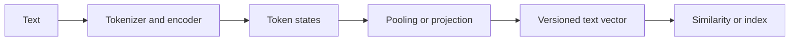

# Embeddings
TL;DR: An embedding maps a discrete item or text input to a learned vector, and whether vector distance is useful depends on how that representation was trained and evaluated.

## Prerequisites

Know that tokenization maps text to IDs and a neural network maps IDs to numeric representations. This lesson distinguishes token embeddings inside a language model from pooled sentence/document vectors used for retrieval, clustering, and ranking.

## Learning Outcomes

- Distinguish static word vectors, contextual hidden states, and task-trained sentence embeddings.
- Compute cosine similarity and explain its normalization assumption.
- Choose a pooling and retrieval evaluation strategy for a stated task.
- Diagnose embedding-space mismatch using labeled examples and retrieval metrics.

## Core Intuition

An embedding is a coordinate representation learned for a particular objective. In a useful sentence-embedding space, examples relevant to a query tend to be closer than irrelevant examples under the chosen similarity function. This is not a guarantee that each coordinate corresponds to a human-readable property, nor that geometric closeness means “same meaning” in every context. Geometry reflects the training data, objective, pooling method, and evaluation distribution.

Static word embeddings such as Word2Vec assign one vector to each vocabulary item. They are compact and inexpensive, but `bank` has one representation whether the sentence discusses a loan or a river. Transformer hidden states are contextual: the representation for `bank` can differ by sentence. A hidden state is not automatically a good sentence vector. To compare whole texts, a model needs a pooling rule or a training objective that makes the resulting vectors useful for the intended comparison.

## How It Works

An embedding table is a matrix `E ∈ R^(V×d)`, where `V` is vocabulary size and `d` is embedding dimension. An input token ID selects one row. During language-model training these rows are updated by gradient descent along with other model weights. The resulting token vectors are intermediate features; later layers contextualize them using surrounding tokens.

Word2Vec's skip-gram objective predicts context words from a center word; CBOW predicts a center word from context. Both learn static vectors from co-occurrence. In a transformer encoder, each layer combines token features with context. A sentence encoder may produce one vector via mean pooling, a designated position, or a learned pooling head. Contrastive objectives train paired texts to score above non-matching texts, often using a similarity function and in-batch negatives. The objective and data determine which distinctions the vector preserves.

For vectors `u` and `v`, cosine similarity is `(u·v)/(||u||₂ ||v||₂)`. It compares direction and is invariant to positive scaling, but it is undefined for zero vectors and discards magnitude. Dot product uses both angle and magnitude. Euclidean distance also depends on magnitude. L2-normalizing vectors makes cosine ranking equivalent to dot-product ranking, which can simplify some indexes. The choice must match the model's training objective and the index implementation.

In retrieval, encode corpus passages and queries with compatible model versions, index corpus vectors, retrieve top-k candidates, then evaluate relevance. A practical split is to measure retrieval with Recall@k or nDCG@k against judged query-document pairs and measure downstream answer quality separately. If the task requires exact identifiers, dates, or rare product codes, combine dense retrieval with lexical search; semantic closeness can blur distinctions that exact matching preserves.

### Workflow Flowchart



## Trade-offs

| Representation | Strength | Limitation | Appropriate use |
|---|---|---|---|
| Static word vector | Fast lookup and small inference cost | No context; vocabulary/OOV handling needed | Similarity or features for a stable, narrow vocabulary |
| Contextual token states | Represents a token in its sentence | Requires encoder and a deliberate pooling rule | Token-level labeling or inputs to a trained pooling head |
| General sentence encoder | Reusable text vector with efficient indexing | May miss domain terms or task-specific relevance | Baseline semantic retrieval and clustering |
| Task-trained bi-encoder | Can align query/document relevance directly | Needs representative labels and re-embedding when changed | Search where quality justifies training and operations cost |

Dimension is a storage and compute parameter, not a quality ranking by itself. For `n` vectors of dimension `d` stored as float32, raw vector storage is approximately `4nd` bytes before index overhead. Reducing `d` lowers storage and distance-computation cost, but may discard useful signal. Compare candidate dimensions and encoders using the same judged queries, corpus, index settings, and latency budget. Record model version, tokenizer, pooling, normalization, and dimension with every indexed vector; changing any of them generally requires re-embedding the corpus.

## Implementation

This dependency-light example computes cosine similarity and explicitly handles zero vectors. It demonstrates the metric, not a learned embedding model.

```python
from math import sqrt

def cosine(a, b):
    if len(a) != len(b):
        raise ValueError("vectors must have the same dimension")
    dot = sum(x * y for x, y in zip(a, b))
    norm_a = sqrt(sum(x * x for x in a))
    norm_b = sqrt(sum(y * y for y in b))
    if norm_a == 0 or norm_b == 0:
        raise ValueError("cosine similarity is undefined for a zero vector")
    return dot / (norm_a * norm_b)

query = [1.0, 0.0]
assert abs(cosine(query, [2.0, 0.0]) - 1.0) < 1e-9
assert abs(cosine(query, [0.0, 1.0])) < 1e-9
try:
    cosine(query, [1.0])
except ValueError as error:
    assert str(error) == "vectors must have the same dimension"
else:
    raise AssertionError("mismatched dimensions must be rejected")
print(cosine(query, [0.8, 0.6]))
```

When using a pretrained sentence encoder, use the same documented query/document encoding path expected by that model. A tokenizer change, inconsistent prefixes, mismatched pooling, or comparing vectors from different model versions can invalidate similarity scores even when dimensions match.

## Failure Modes

- **Treating closeness as truth:** semantically similar text can be factually incompatible, such as two different product versions. Inspect false positives and evaluate with labeled relevance judgments; add exact filters or reranking when required.
- **Pooling an unsuitable representation:** averaging hidden states from a model not trained for sentence similarity can yield poor rankings. Establish a lexical baseline and compare candidate pooling methods on the target queries.
- **Embedding/index version mismatch:** same-dimensional vectors from different encoders are not generally in the same space. Store model and preprocessing versions; rebuild indexes on changes.
- **Domain or language shift:** generic training data may not represent specialist vocabulary. Report Recall@k by domain/language and collect targeted examples before fine-tuning or switching encoders.
- **Metric/normalization mismatch:** cosine and dot product can rank results differently when vector norms vary. Match index metric to the training/evaluation setup and test with hand-computed vectors.
- **Stale corpus vectors:** document edits do not update an existing vector automatically. Track source revision and re-embed changed passages; monitor freshness as well as retrieval relevance.

## Interview Quick Reference

| Question | Answer |
|---|---|
| What is an embedding? | A learned mapping from an item to a vector whose useful relationships are defined by its training objective and evaluation task. |
| Static versus contextual? | A static word has one stored vector; contextual models produce representations dependent on surrounding tokens. A contextual token state still needs suitable pooling for sentence search. |
| Cosine versus dot product? | Cosine compares direction; dot product also reflects norms. Normalization makes their rankings equivalent only when both sides are normalized consistently. |
| Debugging follow-up: retrieval misses exact versions. | Inspect the missed query and candidates, stratify exact-match and semantic relevance, then add lexical or metadata constraints and re-evaluate Recall@k and final task quality. |

## Related Concepts

- [Tokenization](01-tokenization.md) — token IDs are inputs to embedding tables.
- [Semantic Search](21-semantic-search.md) — vector retrieval and evaluation.
- [RAG](18-rag.md) — embeddings are one component of retrieval-augmented generation.
- [Vector Databases](20-vector-databases.md) — index and query vectors at scale.
- [Transfer Learning](../../ml/concepts/transfer-learning.md) — reuse of pretrained representations.
- [Embeddings notebook](../notebooks/02-embeddings.ipynb) — paired walkthrough.
- [Embeddings practice](../interview-prep/curriculum-practice.md#embeddings) — manifest-linked assessment.

## Resources

- [Word2Vec: Efficient Estimation of Word Representations in Vector Space](https://arxiv.org/abs/1301.3781)
- [BERT: Pre-training of Deep Bidirectional Transformers](https://arxiv.org/abs/1810.04805)
- [Sentence-BERT: Sentence Embeddings using Siamese BERT-Networks](https://arxiv.org/abs/1908.10084)
- [Sentence Transformers documentation](https://www.sbert.net/)
- [Pinecone: Understanding vector embeddings](https://www.pinecone.io/learn/vector-embeddings/)

## Concept Relationships

Token embeddings are learned as part of a language model; retrieval vectors are derived with a task-appropriate encoder and pooling method. Embeddings notebook: [02-embeddings.ipynb](../notebooks/02-embeddings.ipynb). Practice: [embeddings questions](../interview-prep/curriculum-practice.md#embeddings).

## Interview Questions

**How would you decide whether to fine-tune an embedding model?**

Build a representative judged query set and establish lexical and off-the-shelf dense baselines. Fine-tune only when errors are systematic and enough trustworthy relevance pairs exist. Hold out query families, report ranking metrics by slice, and include index rebuild, latency, and monitoring costs in the decision. A higher cosine score by itself is not evidence of better retrieval.
