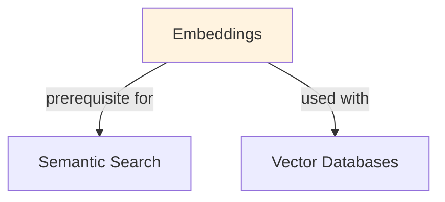

# Embeddings

Words are just labels—meaningless.

## Prerequisites

Familiarity with tokenization. This note focuses on the LLM-specific mechanism and its engineering selection boundary.

## Learning Outcomes

- Explain the mechanism and assumptions behind embeddings.
- Compare its main alternative using task quality and one operational cost.
- Diagnose a failure using a metric or example tied to embeddings.

## Core Intuition

Words are just labels—meaningless. Embeddings translate them into geometry. Two words mean similar things if their vectors are near each other (low distance). The embedding space captures semantic and syntactic structure learned from data.

## How It Works

**Static Embeddings (Word2Vec, GloVe):**
- Each word → one fixed vector (e.g., "king" always = [0.2, 0.5, -0.1])
- Learned via matrix factorization (SVD) or prediction tasks (skip-gram, CBOW)
- Fast inference but ignore context (homonyms: "bank" has one vector, not two)

**Contextual Embeddings (BERT, LLaMA):**
- Same word → different vectors depending on context ("bank deposit" vs "river bank")
- Produced by transformer layers; meaning shifts based on surrounding tokens
- Slower but capture polysemy

**Similarity in Embedding Space:**
```
similarity(u, v) = cos(u, v) = (u · v) / (||u|| ||v||)
```
Cosine similarity preferred because:
- Direction matters, magnitude doesn't
- Robust to scaling
- Range: [-1, 1], interpretable

**Text Embeddings (Sentence/Document):**
- Average token embeddings (simple but noisy)
- Use special tokens (CLS token from BERT)
- Task-specific fine-tuning (contrastive learning on pairs)
- Specialized models (Sentence-BERT, MPNet)

### Workflow Flowchart


## Trade-offs

| Property | Static | Contextual | Task-Specific |
|----------|--------|-----------|---------------|
| Speed | ⭐⭐⭐⭐⭐ | ⭐⭐ | ⭐⭐⭐ |
| Semantic quality | ⭐⭐⭐ | ⭐⭐⭐⭐⭐ | ⭐⭐⭐⭐⭐ |
| Polysemy handling | ✗ | ✓ | ✓ |
| Memory footprint | ⭐⭐⭐⭐⭐ | ⭐ | ⭐ |
| Training data req | ⭐⭐ | ⭐⭐⭐⭐ | ⭐⭐⭐ |

**Dimension trade-offs:**
- 50-100D: fast, compact, low semantic quality
- 300D (Word2Vec default): balanced (similarity search, clustering)
- 768D (BERT-base): rich but slower, overkill for some tasks
- 1536D+ (large models): highest quality but memory/latency expensive

## Implementation

```python
import numpy as np
from sklearn.metrics.pairwise import cosine_similarity
from sentence_transformers import SentenceTransformer

# Static embedding lookup (simulate Word2Vec)
embeddings = {
    "king": np.array([0.5, 0.2, -0.3]),
    "queen": np.array([0.48, 0.25, -0.28]),
    "man": np.array([0.3, 0.1, -0.1]),
    "woman": np.array([0.32, 0.15, -0.08]),
}

# Cosine similarity
sim = cosine_similarity([embeddings["king"]], [embeddings["queen"]])[0][0]
print(f"Similarity(king, queen) = {sim:.3f}")  # ≈ 0.999

# Word vector arithmetic: king - man + woman ≈ queen
# (demonstrates semantic structure)
king_man_woman = embeddings["king"] - embeddings["man"] + embeddings["woman"]
closest = min(embeddings.items(), 
              key=lambda x: np.linalg.norm(x[1] - king_man_woman))
print(f"king - man + woman ≈ {closest[0]}")  # ≈ "queen"

# Contextual embeddings (BERT-based)
model = SentenceTransformer('all-MiniLM-L6-v2')  # 384D
sentences = [
    "The bank approved the loan.",
    "We walked along the river bank.",
    "The river flows downstream."
]
embeddings_contextual = model.encode(sentences)  # (3, 384)
sims = cosine_similarity(embeddings_contextual)
print(sims)
# Sentence 1 & 2 both have "bank" but low similarity (different context)
```

## Failure Modes

- **Assuming embeddings are "meaningful":** They're learned, not interpretable. Don't try to understand dimensions individually.
- **Not normalizing for cosine similarity:** Magnitudes can vary; always normalize or use cosine directly.
- **Reusing embeddings across domains:** "COVID" embeddings from news ≠ "COVID" in medical text. Fine-tune or retrain.
- **Averaging subword tokens:** "unbelievable" tokenizes as ["un", "believe", "able"]. Averaging produces noise; use CLS token or fine-tune pooling.
- **Ignoring temporal drift:** Word meanings change (e.g., "tweet"). Embeddings trained on old data diverge from modern usage.
- **Using L2 distance instead of cosine:** Both work but cosine is scale-invariant; L2 is direction + magnitude.

## Interview Quick Reference

| Question | What to say |
|---|---|
| "What are embeddings?" | Dense vectors representing tokens/text in semantic space. Similar meanings = nearby vectors. |
| "Static vs contextual?" | Static: fast, one vector per word (Word2Vec). Contextual: slower, meaning depends on context (BERT). |
| "Why cosine similarity?" | Scale-invariant, interprets direction not magnitude. Range [-1,1] is interpretable. |
| "How to embed documents?" | Average token embeddings, use CLS token from BERT, or fine-tune task-specific pooling. |
| "Dimension choice?" | 300D (balanced), 768D (high quality, slower), 1536D+ (state-of-the-art, expensive). |
| "Embedding drift?" | Word meanings shift over time. Retrain periodically or use recent data. |


**Design follow-up:** How would you monitor this choice in production and decide when to use an alternative?
## Related Concepts

- [Tokenization](01-tokenization.md) — tokens are what get embedded
- [Semantic Search](21-semantic-search.md) — embeddings enable fast similarity search
- [RAG](18-rag.md) — embeddings for retrieval in augmented generation
- [Vector Databases](20-vector-databases.md) — storing and indexing embeddings at scale
- [Transfer Learning](../../ml/concepts/transfer-learning.md) — using pre-trained embeddings

## Real-World Examples

### Semantic Search for Documentation
Company docs: 50K pages. Lexical search (Elasticsearch): 'GPU memory optimization' → relevant pages ranked #4-10. Embedding search: 'How to optimize GPU memory?' → relevant pages ranked #1-3. Implementation: embed all docs once, vector DB query. Latency: <50ms. User satisfaction: 72% → 91%.

### Duplicate Detection in E-Commerce
Problem: same product listed 5x with different descriptions. Lexical comparison: false negatives (different wording). Embedding cosine sim > 0.85: catches 95% duplicates. Pipeline: embed product descriptions, cluster with threshold. Saves manual curation hours.

### Job Matching in Recruitment
Job postings: 1M. Candidates: 500K. Lexical keyword matching: low coverage. Embedding-based: candidate skills → embed → search job postings → top-k matches. E.g., 'Python developer' matches 'Software engineer (Python)' and 'Backend engineer (preferred: Python)'. Better ranking of opportunities.

## Real-World Examples

### Semantic Search for Documentation
Company docs: 50K pages. Lexical search (Elasticsearch): 'GPU memory optimization' → relevant pages ranked #4-10. Embedding search: 'How to optimize GPU memory?' → relevant pages ranked #1-3. Implementation: embed all docs once, vector DB query. Latency: <50ms. User satisfaction: 72% → 91%.

### Duplicate Detection in E-Commerce
Problem: same product listed 5x with different descriptions. Lexical comparison: false negatives (different wording). Embedding cosine sim > 0.85: catches 95% duplicates. Pipeline: embed product descriptions, cluster with threshold. Saves manual curation hours.

### Job Matching in Recruitment
Job postings: 1M. Candidates: 500K. Lexical keyword matching: low coverage. Embedding-based: candidate skills → embed → search job postings → top-k matches. E.g., 'Python developer' matches 'Software engineer (Python)' and 'Backend engineer (preferred: Python)'. Better ranking of opportunities.

## Real-World Examples

### Semantic Search for Documentation
Company docs: 50K pages. Lexical search (Elasticsearch): 'GPU memory optimization' → relevant pages ranked #4-10. Embedding search: 'How to optimize GPU memory?' → relevant pages ranked #1-3. Implementation: embed all docs once, vector DB query. Latency: <50ms. User satisfaction: 72% → 91%.

### Duplicate Detection in E-Commerce
Problem: same product listed 5x with different descriptions. Lexical comparison: false negatives (different wording). Embedding cosine sim > 0.85: catches 95% duplicates. Pipeline: embed product descriptions, cluster with threshold. Saves manual curation hours.

### Job Matching in Recruitment
Job postings: 1M. Candidates: 500K. Lexical keyword matching: low coverage. Embedding-based: candidate skills → embed → search job postings → top-k matches. E.g., 'Python developer' matches 'Software engineer (Python)' and 'Backend engineer (preferred: Python)'. Better ranking of opportunities.

## Real-World Examples

### Semantic Search for Documentation
Company docs: 50K pages. Lexical search (Elasticsearch): 'GPU memory optimization' → relevant pages ranked #4-10. Embedding search: 'How to optimize GPU memory?' → relevant pages ranked #1-3. Implementation: embed all docs once, vector DB query. Latency: <50ms. User satisfaction: 72% → 91%.

### Duplicate Detection in E-Commerce
Problem: same product listed 5x with different descriptions. Lexical comparison: false negatives (different wording). Embedding cosine sim > 0.85: catches 95% duplicates. Pipeline: embed product descriptions, cluster with threshold. Saves manual curation hours.

### Job Matching in Recruitment
Job postings: 1M. Candidates: 500K. Lexical keyword matching: low coverage. Embedding-based: candidate skills → embed → search job postings → top-k matches. E.g., 'Python developer' matches 'Software engineer (Python)' and 'Backend engineer (preferred: Python)'. Better ranking of opportunities.

## Real-World Examples

### Semantic Search for Documentation
Company docs: 50K pages. Lexical search (Elasticsearch): 'GPU memory optimization' → relevant pages ranked #4-10. Embedding search: 'How to optimize GPU memory?' → relevant pages ranked #1-3. Implementation: embed all docs once, vector DB query. Latency: <50ms. User satisfaction: 72% → 91%.

### Duplicate Detection in E-Commerce
Problem: same product listed 5x with different descriptions. Lexical comparison: false negatives (different wording). Embedding cosine sim > 0.85: catches 95% duplicates. Pipeline: embed product descriptions, cluster with threshold. Saves manual curation hours.

### Job Matching in Recruitment
Job postings: 1M. Candidates: 500K. Lexical keyword matching: low coverage. Embedding-based: candidate skills → embed → search job postings → top-k matches. E.g., 'Python developer' matches 'Software engineer (Python)' and 'Backend engineer (preferred: Python)'. Better ranking of opportunities.

## Real-World Examples

### Semantic Search for Documentation
Company docs: 50K pages. Lexical search (Elasticsearch): 'GPU memory optimization' → relevant pages ranked #4-10. Embedding search: 'How to optimize GPU memory?' → relevant pages ranked #1-3. Implementation: embed all docs once, vector DB query. Latency: <50ms. User satisfaction: 72% → 91%.

### Duplicate Detection in E-Commerce
Problem: same product listed 5x with different descriptions. Lexical comparison: false negatives (different wording). Embedding cosine sim > 0.85: catches 95% duplicates. Pipeline: embed product descriptions, cluster with threshold. Saves manual curation hours.

### Job Matching in Recruitment
Job postings: 1M. Candidates: 500K. Lexical keyword matching: low coverage. Embedding-based: candidate skills → embed → search job postings → top-k matches. E.g., 'Python developer' matches 'Software engineer (Python)' and 'Backend engineer (preferred: Python)'. Better ranking of opportunities.

## Real-World Examples

### Semantic Search for Documentation
Company docs: 50K pages. Lexical search (Elasticsearch): 'GPU memory optimization' → relevant pages ranked #4-10. Embedding search: 'How to optimize GPU memory?' → relevant pages ranked #1-3. Implementation: embed all docs once, vector DB query. Latency: <50ms. User satisfaction: 72% → 91%.

### Duplicate Detection in E-Commerce
Problem: same product listed 5x with different descriptions. Lexical comparison: false negatives (different wording). Embedding cosine sim > 0.85: catches 95% duplicates. Pipeline: embed product descriptions, cluster with threshold. Saves manual curation hours.

### Job Matching in Recruitment
Job postings: 1M. Candidates: 500K. Lexical keyword matching: low coverage. Embedding-based: candidate skills → embed → search job postings → top-k matches. E.g., 'Python developer' matches 'Software engineer (Python)' and 'Backend engineer (preferred: Python)'. Better ranking of opportunities.

## Topic-specific notes

**Q: When should you use a sentence embedding model vs computing embeddings from a base LLM?**
A: Sentence embedding models (sentence-transformers) are fine-tuned with contrastive losses specifically to make semantically similar texts cluster together. Base LLM embeddings from the last hidden state are often poor for retrieval because they're optimized for next-token prediction, not similarity. Use sentence-transformers for RAG/search; use base LLM embeddings only if you're fine-tuning on a downstream task.

**Q: What is the curse of dimensionality and how does it affect embedding similarity search?**
A: In high dimensions, cosine similarity between random vectors concentrates near 0—everything looks equidistant. This means your top-k nearest neighbors may not be meaningfully more similar than random documents. Mitigate by reducing dimensions (PCA, quantization), using learned metrics, or ensuring your embedding space is well-calibrated through fine-tuning on your domain.

**Q: How do you evaluate whether embeddings are good for your use case?**
A: Run retrieval evaluation: take labeled query-document pairs, embed both, measure recall@k (what fraction of relevant docs appear in top-k results). MTEB (Massive Text Embedding Benchmark) scores are a good starting point. But always evaluate on your domain—a model top on MTEB may underperform a smaller domain-specific model on your data.

**Q: When would you fine-tune embedding models vs use them off-the-shelf?**
A: Fine-tune when off-the-shelf retrieval recall@10 is below ~70% on your eval set, when your domain has specialized vocabulary (legal, medical, code), or when you have labeled query-document pairs from user interactions. Off-the-shelf works well for general English text. Fine-tuning with contrastive loss (positive/negative pairs) typically gives 10-30% recall improvement in specialized domains.

**Q: What are the trade-offs between larger and smaller embedding models?**
A: Larger models (768+ dim, 300M+ params) have higher quality but slower inference and higher storage. Small models (384 dim, 22M params like all-MiniLM-L6-v2) are 5-10x faster with only ~5-10% quality drop for general tasks. In production, embed offline where possible; for real-time queries, use the smallest model that meets your recall threshold.

**Q: How does chunking strategy affect retrieval quality in RAG?**
A: Chunk size creates a precision-recall trade-off. Small chunks (128 tokens) give precise retrieval but lose context. Large chunks (512+ tokens) preserve context but dilute relevance scores. Overlapping chunks (50% overlap) help with boundary sentences. Best practice: chunk at natural boundaries (paragraphs, sections), use hierarchical retrieval (retrieve parent chunk after matching child chunk).

## Resources

- [Word2Vec: Efficient Estimation of Word Representations in Vector Space](https://arxiv.org/abs/1301.3781)
- [BERT: Pre-training of Deep Bidirectional Transformers](https://arxiv.org/abs/1810.04805)
- [Sentence-BERT: Sentence Embeddings using Siamese BERT-Networks](https://arxiv.org/abs/1908.10084)
- [HuggingFace: Sentence Transformers](https://www.sbert.net/)
- [Pinecone: Understanding Embeddings](https://www.pinecone.io/learn/vector-embeddings/)

## Concept Relationships



## Interview Questions

**Q: What are embeddings and why do they matter?**
*A: Embeddings: dense vectors representing text semantics. 'cat' and 'kitten' have similar embeddings (cosine similarity ~0.9). Enables: semantic search, clustering, similarity comparison. All done in vector space, not lexical matching. Standard: 384-1536 dimensions.*

**Q: How do you choose an embedding model?**
*A: Trade-offs: small (all-MiniLM-L6-v2, 22M params, fast), medium (all-mpnet-base-v2, 109M params), large (instructor-xl, slower but better). Benchmark on your domain. MTEB leaderboard shows performance. For production: balance accuracy vs latency. Most: use all-MiniLM for speed, all-mpnet for accuracy.*

**Q: How do you handle embeddings at scale?**
*A: Batch encode: 1000s of texts at once (32-256 batch size). Store in vector DB (Pinecone, Weaviate, Milvus). Index for fast search. Query: embedding → similarity search in DB (not linear scan). Latency: <100ms per query. Storage: 1M docs × 384 dims × 4 bytes = 1.5GB.*

**Q: When would you fine-tune embeddings?**
*A: Pre-trained works for general text. Fine-tune if: domain-specific (medical abstracts, legal docs), task-specific (relevance ranking), distribution shift. Data needed: 10K+ pairs. Improves accuracy 5-15% but adds complexity. Usually not needed.*

**Q: How do you evaluate embedding quality?**
*A: Metrics: mean average precision (MAP), normalized discounted cumulative gain (NDCG), MRR. Test: does top-k nearest neighbor make sense? Do similar documents cluster? Manual inspection essential. MTEB benchmark for standardized eval.*

## Real-World Applications

### Pinecone: Vector search infrastructure
Provides vector databases for storing and searching embeddings at scale. Used by Uber, Slack, DuckDuckGo for semantic search and recommendations.

### Airbnb: Listing search and recommendations
Uses embeddings to compute similarity between listings and user preferences, enabling semantic search beyond keyword matching.

### Spotify: Music recommendations
Generates embeddings for songs and user preferences. Uses cosine similarity to recommend songs that are semantically similar in taste space.

## Best Practices

- Normalize embeddings to unit vectors for efficient cosine similarity (dot product = cosine similarity).
- Use contrastive training (sentence-BERT) for better semantic representations than vanilla transformers.
- Dimension reduction (PCA, UMAP) can improve efficiency for downstream tasks without much quality loss.
- Fine-tune embeddings on domain-specific data for better domain relevance.

## Common Pitfalls to Avoid

- **Using overly generic embeddings for specialized domains**: Using overly generic embeddings for specialized domains: task-specific fine-tuning usually helps
- **Not normalizing embeddings**: Not normalizing embeddings: breaks cosine similarity assumptions
- **Using too-large models for simple tasks**: Using too-large models for simple tasks: waste of compute; smaller models often sufficient
- **Outdated embedding models**: Outdated embedding models: new models (Sentence-BERT v2) have much better quality
