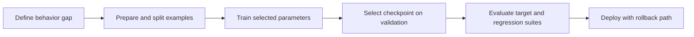

# Fine-tuning
TL;DR: Fine-tuning continues optimization from a pretrained checkpoint on a defined target objective, trading training and evaluation cost for a behavior change encoded in model weights.

## Prerequisites

Understand next-token pretraining, train/validation/test splits, and gradient-based optimization. This lesson covers supervised adaptation of language models; instruction tuning is a specialized data and objective pattern, while LoRA changes which parameters are trainable.

## Learning Outcomes

- Describe how a supervised example contributes a loss and gradient during fine-tuning.
- Decide whether a behavior gap calls for prompting, retrieval, supervised tuning, or preference optimization.
- Design a leakage-resistant evaluation that measures the intended behavior and retained capabilities.
- Diagnose underfitting, overfitting, forgetting, or data contamination from concrete signals.

## Core Intuition

Pretraining teaches a model broad statistical regularities by predicting text. Fine-tuning makes a smaller, explicit set of examples influential for a target behavior: given an input and a desired response, update some or all model parameters so that the response becomes more likely. It does not add a clean database entry or guarantee that facts will be recalled reliably. It changes a distributed parameter state, which can alter multiple behaviors at once.

Use an analogy of adjusting a trained musician's technique for a particular repertoire: practice can improve a target performance, but a narrow rehearsal schedule may weaken neglected skills. The analogy has limits: model updates are numerical optimization, and the effect depends on architecture, data, optimizer, and scale. The practical question is not “how many examples always suffice?” but “does this data and training recipe improve the behavior on held-out cases without unacceptable regressions?”

## How It Works

For a causal language model, training data is serialized as token sequences. At selected target positions, the model produces logits `z_t`; softmax gives `p(token | preceding tokens)`. The usual token-level cross-entropy is `L = -Σ_t m_t log p(y_t | x_<t) / Σ_t m_t`, where `m_t` is a mask indicating which positions contribute to loss. In full fine-tuning, gradients update the selected model parameters. In parameter-efficient tuning, the base weights are frozen and a smaller parameter set is trained; see [LoRA](08-lora.md).

The data contract matters. Each example should identify the intended input, target, formatting, and which tokens receive loss. For conversational SFT, many recipes mask user/prompt tokens and train on assistant answer tokens; other objectives may use a different mask. Duplicates, train/test overlap, incorrect labels, and inconsistent templates can dominate apparent quality. Deduplicate and split by source, user, document, or time where examples are correlated; random row splits can leak near-duplicates across partitions.

Before tuning, define the observed failure and an evaluation set that represents it. Compare against prompt-only, retrieval, or a smaller baseline. A model update is attractive when the target behavior is repeated and stable, the examples are lawful and representative, and inference-time adaptation cannot meet requirements. Retrieval is often better for frequently changing factual content; prompting is easier to revise when the task is already within the model's capability. Supervised tuning is not a substitute for a reliable source of current facts.

Training usually monitors training and validation loss plus task-specific metrics. Lower validation loss means better likelihood on that held-out distribution, not necessarily better instruction following, factuality, safety, or user value. Evaluate with a fixed test set and targeted human or programmatic judgments. Compare paired outputs under the same decoding configuration and include regression tests for capabilities the base model must retain. Select checkpoints on validation evidence; do not repeatedly tune against the final test set.

### Workflow Flowchart



## Trade-offs

| Approach | Strength | Cost or limitation | Prefer when |
|---|---|---|---|
| Prompting | Fast iteration; no model artifact | Prompt length and output may vary; capability may be insufficient | A clear instruction elicits behavior already present |
| Retrieval (RAG) | External facts can be updated and cited | Requires indexed sources and retrieval quality | Answers depend on changing or auditable knowledge |
| Full fine-tuning | All selected weights can adapt; no adapter routing | Highest optimizer/state memory and checkpoint management cost | Strong evidence supports broad parameter updates |
| LoRA/PEFT | Fewer trainable parameters and compact task artifact | Capacity and target-module choices constrain adaptation | Hardware or multi-task deployment favors adapters |

There is no general example-count or accuracy guarantee. Useful data volume depends on task variation, base-model capability, label consistency, sequence length, and optimization. Likewise, learning rates are recipe- and model-dependent; start from a validated recipe for the architecture, run controlled experiments, and monitor divergence rather than adopting a universal number. Report dataset composition, split policy, training tokens, compute, and evaluation uncertainty so a result can be interpreted and reproduced.

## Implementation

This runnable standard-library example demonstrates a deterministic, group-aware split. It is not a trainer; its purpose is to make leakage prevention concrete before any optimization begins.

```python
from collections import defaultdict

examples = [
    {"group": "doc-a", "text": "question 1", "target": "answer 1"},
    {"group": "doc-a", "text": "question 2", "target": "answer 2"},
    {"group": "doc-b", "text": "question 3", "target": "answer 3"},
    {"group": "doc-c", "text": "question 4", "target": "answer 4"},
]
by_group = defaultdict(list)
for row in examples:
    by_group[row["group"]].append(row)

test_groups = {"doc-c"}
train = [r for g, rows in by_group.items() if g not in test_groups for r in rows]
test = [r for g, rows in by_group.items() if g in test_groups for r in rows]
assert {r["group"] for r in train}.isdisjoint({r["group"] for r in test})
assert len(train) + len(test) == len(examples)
print(f"train={len(train)}, test={len(test)}")
```

For an actual fine-tune, pin the base model and tokenizer, define prompt/target serialization and loss masking, save the training configuration, and keep the test set inaccessible to checkpoint selection. The paired notebook and implementation currently demonstrate pretrained-model inference; they do not train or fine-tune a model. Treat the split above as preparation for training, not as a training run.

## Failure Modes

- **Leakage through duplicates or shared sources:** evaluation appears strong because related examples occur in train and test. Split by source/group/time and use near-duplicate checks; report the split unit.
- **Training the wrong tokens:** loss on user prompts, padding, or template markers may teach unintended behavior. Inspect tokenized examples and masks, then unit-test which positions contribute to loss.
- **Overfitting or narrow behavior:** training loss falls while held-out behavior stalls or regresses. Compare validation curves and capability slices; reduce epochs, improve coverage, regularize, or reconsider fine-tuning.
- **Catastrophic forgetting:** the target score rises while general capabilities or safety behavior falls. Keep a regression suite, mix representative data only when justified, and retain a rollback checkpoint.
- **Mistaking likelihood for task success:** perplexity can improve without better answers. Evaluate the target metric and human judgments directly, with fixed decoding and blinded comparisons where possible.
- **Reproducibility failure:** undocumented base revision, tokenizer, data filtering, or random seed makes outcomes incomparable. Version these inputs and save configuration, checkpoint-selection rule, and evaluation results.

## Interview Quick Reference

| Question | Answer |
|---|---|
| Fine-tuning versus RAG? | Tuning changes model parameters for repeated behavior; RAG supplies external context at inference and is easier to update. Choose based on whether the gap is behavior or changing knowledge. |
| How do you know tuning helped? | Predefine held-out target and regression evaluations, compare with a baseline, and report uncertainty and slices; training loss alone is insufficient. |
| Full fine-tuning versus LoRA? | Full tuning updates selected base weights and has a higher adaptation capacity/cost; LoRA freezes them and trains low-rank updates, reducing trainable state with task-dependent quality. |
| Debugging follow-up: training loss improves but users see no gain. | Verify that the training target matches the product behavior, inspect loss masks and held-out examples, test for leakage, then evaluate outputs with the actual task metric and deployment prompt. |

## Related Concepts

- [Pretraining](03-pretraining.md) — the initialization and objective fine-tuning builds on.
- [Instruction Tuning](05-instruction-tuning.md) — supervised adaptation over instruction-response examples.
- [RLHF](06-rlhf.md) — preference-based post-training.
- [LoRA](08-lora.md) — low-rank parameter-efficient updates.
- [Transfer Learning](../../ml/concepts/transfer-learning.md) — adaptation from a pretrained checkpoint.
- [Fine-tuning notebook](../notebooks/04-finetuning.ipynb) — paired walkthrough.
- [Fine-tuning practice](../interview-prep/curriculum-practice.md#fine-tuning) — paired assessment.

## Resources

- [Hugging Face Transformers: Training](https://huggingface.co/docs/transformers/training)
- [Fine-Tuning Language Models from Human Preferences](https://arxiv.org/abs/1909.08383)
- [Training language models to follow instructions with human feedback](https://arxiv.org/abs/2203.02155)
- [LoRA: Low-Rank Adaptation of Large Language Models](https://arxiv.org/abs/2106.09685)
- [Transformers Trainer API](https://huggingface.co/docs/transformers/main_classes/trainer)
- [QLoRA: Efficient Finetuning of Quantized LLMs](https://arxiv.org/abs/2305.14314)

## Concept Relationships

Fine-tuning is a family of adaptation procedures; the target format and trainable parameters distinguish instruction tuning and LoRA. Notebook: [04-finetuning.ipynb](../notebooks/04-finetuning.ipynb). Practice: [fine-tuning questions](../interview-prep/curriculum-practice.md#fine-tuning).

## Interview Questions

**How would you separate data problems from optimization problems?**

First manually inspect a stratified sample and verify serialization, labels, duplicates, and loss masks. Then run a tiny overfit test: the model should fit a very small clean batch under the intended objective. If that fails, debug the implementation; if it succeeds but held-out performance is weak, inspect split shift, label quality, coverage, and model capacity before increasing compute.
