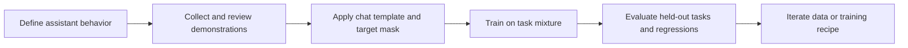

# Instruction Tuning
TL;DR: Instruction tuning is supervised fine-tuning on examples framed as tasks or requests, intended to make a pretrained model respond usefully to instructions across a distribution of tasks.

## Prerequisites

Understand causal language modeling and supervised fine-tuning. Instruction tuning is a data and training objective pattern, not a separate model architecture or a guarantee of alignment; preference optimization and safety evaluation address additional questions.

## Learning Outcomes

- Distinguish instruction-tuning examples from raw next-token pretraining and narrow task fine-tuning.
- Explain how prompt/response formatting and loss masks determine the behavior being trained.
- Design a task-diverse training and held-out evaluation split that tests generalization.
- Diagnose instruction overfitting, task imbalance, and template mismatch from targeted examples.

## Core Intuition

A pretrained language model learns to continue text. An instruction-tuned model is further trained on demonstrations where a request is paired with a desired response. This makes task framing part of the learned input-output pattern. For example, a raw corpus may contain an encyclopedia article; an instruction example may ask “Summarize this passage in two sentences” and provide a summary. The second form directly demonstrates the desired mapping.

The breadth of the demonstrations matters. Training only on sentiment classification teaches a narrow task mapping, even if each row is written as an instruction. A mixture of tasks, phrasings, domains, and response constraints can encourage transfer to unseen combinations, but no fixed task count or dataset size guarantees that transfer. A system tuned for helpful answers also needs evaluation for correctness, refusal behavior, privacy, and other product requirements. Instruction tuning supplies demonstrations; it does not certify the resulting behavior.

## How It Works

An example is usually serialized as a prompt `x` and target answer `y`, perhaps with role markers, delimiters, or a chat template. The model is trained with next-token cross-entropy on target tokens. A mask can set loss to zero for prompt positions so the example teaches the answer conditional on the request. Template tokens and turn boundaries must match the serving-time format. Training on one template and serving another creates a distribution shift even if the words appear similar.

Task diversity can be introduced by mixing datasets such as summarization, extraction, coding, translation, and question answering. The sampling policy determines which tasks dominate optimization: equal rows may not mean equal influence if answer lengths differ. Inspect examples and token counts by task, language, and response type. Deduplicate source content before splitting; otherwise the same answer or source passage can leak across train and evaluation. Hold out task families or instruction phrasings when the claim is generalization to new tasks or wording.

Instruction tuning is commonly one stage of post-training. A model may then undergo preference optimization using comparisons or rankings, and separate safety and policy evaluation. These stages have different supervision: a demonstration says what answer to imitate; a preference label says which output is preferred among alternatives. Do not describe ordinary instruction tuning as human-feedback optimization unless preferences actually enter the objective.

Evaluate both familiar and held-out requests. Use task-specific exact-match or structured-output checks when possible, human ratings for open-ended quality, and targeted regression sets for factuality and safety. Test format constraints, ambiguous instructions, multilingual requests, and adversarial or out-of-scope inputs. A gain on an aggregate benchmark may hide a regression in a small task or language slice; report per-task results and uncertainty.

### Workflow Flowchart



## Trade-offs

| Data strategy | Benefit | Risk | Useful when |
|---|---|---|---|
| Single-task demonstrations | Clear target and easier diagnosis | Narrow behavior and phrasing overfit | A bounded product task has stable input/output |
| Multi-task mixture | Covers diverse requests and may support transfer | Task imbalance and conflicting styles | The model must handle a family of tasks |
| Synthetic demonstrations | Can scale coverage and formatting | Teacher errors and style artifacts propagate | Synthetic data is filtered and checked against trusted tests |
| Human-reviewed demonstrations | Better control over correctness and tone | Annotation time, disagreement, and cost | Quality-sensitive behaviors need explicit targets |

Quality and coverage are separate dimensions. A large set of duplicated or low-quality examples can reinforce one flawed pattern; a small set may omit important cases. Measure duplicate rate, task/language coverage, answer quality, and label agreement. Keep the evaluation set independently curated and frozen. If the primary need is current factual knowledge, retrieval is often more appropriate than teaching facts through examples. If the model already follows a task under a good prompt, additional tuning may not justify the regression and maintenance risk.

## Implementation

This dependency-light example formats one instruction-response record and constructs a token-level loss mask. The symbolic tokens stand in for a tokenizer's actual IDs; the example makes the supervision boundary explicit.

```python
def build_training_example(instruction, answer):
    prompt = ["<user>", instruction, "<assistant>"]
    target = [answer, "<eos>"]
    tokens = prompt + target
    loss_mask = [0] * len(prompt) + [1] * len(target)
    return tokens, loss_mask

tokens, mask = build_training_example(
    "Return the sentiment label for: I loved the film.", "positive"
)
assert len(tokens) == len(mask)
assert sum(mask) == 2
assert all(value == 0 for value in mask[:3])
print(list(zip(tokens, mask)))
```

In a real trainer, use the model's supported chat template and tokenizer, construct labels with the intended ignore index, and inspect decoded examples alongside masks. Do not assume a literal `[INST]` string is correct for every checkpoint. The paired notebook currently demonstrates pretrained-model inference; it does not run instruction-tuning training. Use it to inspect inference behavior, and treat this example as a demonstration of how training records and loss masks are prepared.

## Failure Modes

- **Template mismatch:** the model is trained with separators or role order that serving never uses. Compare rendered training prompts to production requests and test a handful of exact serialized examples end to end.
- **Prompt tokens receive unintended loss:** the model learns to reproduce user text or formatting rather than answer it. Decode labels/masks for each role and assert that only intended target positions contribute.
- **Task imbalance:** one task or long-answer category dominates the token loss. Report target-token counts by task and evaluate per task; adjust sampling based on measured gaps.
- **Instruction phrasing overfit:** performance falls on paraphrases despite strong training scores. Hold out phrasings and task templates, then add representative variation rather than duplicating near-identical prompts.
- **Synthetic teacher artifacts:** generated demonstrations contain plausible but false claims or a single model's style. Audit samples against trusted sources and tests; include provenance and filtering rules.
- **Calling imitation “alignment”:** the model imitates demonstrations but may fail preference, safety, or robustness requirements. Evaluate those objectives independently and use the corresponding supervision where needed.

## Interview Quick Reference

| Question | Answer |
|---|---|
| What does instruction tuning teach? | It trains on requests paired with desired responses, shifting a pretrained model toward conditional task completion rather than arbitrary continuation. |
| How does it differ from generic SFT? | It is a common SFT setup whose examples are phrased as instructions; SFT also includes narrow input-target mappings that need not cover instruction following broadly. |
| Why use multiple tasks? | A mixture can expose varied request patterns and support transfer, but task balance, quality, and held-out evaluation determine whether that actually happens. |
| Debugging follow-up: training examples score well but new wording fails. | Check template and prompt distribution, split by task phrasing, measure by task family, and add carefully reviewed paraphrases only if the desired generalization is supported by evidence. |

## Related Concepts

- [Fine-tuning](04-finetuning.md) — the broader supervised adaptation process.
- [RLHF](06-rlhf.md) — preference-based post-training after demonstrations.
- [DPO](07-dpo.md) — direct optimization from preference pairs.
- [In-context learning](15-in-context-learning.md) — inference-time task demonstrations.
- [LoRA](08-lora.md) — parameter-efficient implementation option.
- [Instruction-tuning notebook](../notebooks/05-instruction-tuning.ipynb) — paired walkthrough.
- [Instruction-tuning practice](../interview-prep/curriculum-practice.md#instruction-tuning) — paired assessment.

## Resources

- [Finetuned Language Models Are Zero-Shot Learners (FLAN)](https://arxiv.org/abs/2109.01652)
- [The Flan Collection: Designing Data and Methods for Effective Instruction Tuning](https://arxiv.org/abs/2301.13688)
- [Scaling Instruction-Finetuned Language Models](https://arxiv.org/abs/2210.11416)
- [Llama 2: Open Foundation and Fine-Tuned Chat Models](https://arxiv.org/abs/2307.09288)
- [Stanford Alpaca: A Strong, Replicable Instruction-Following Model](https://crfm.stanford.edu/2023/03/13/alpaca.html)
- [OpenAI fine-tuning guide](https://platform.openai.com/docs/guides/fine-tuning)

## Concept Relationships

Instruction tuning is supervised fine-tuning over instruction-shaped demonstrations; preference training uses comparisons rather than a single target answer. Notebook: [05-instruction-tuning.ipynb](../notebooks/05-instruction-tuning.ipynb). Practice: [instruction-tuning questions](../interview-prep/curriculum-practice.md#instruction-tuning).

## Interview Questions

**How would you measure generalization to instructions the model has not seen?**

Create a frozen test set with held-out task families and separately held-out paraphrases, while preventing source or answer leakage. Compare the base and tuned models under the same template and decoding settings; score structured tasks automatically and open-ended tasks with a rubric and blinded review. Report each slice so broad gains cannot hide a regression.
