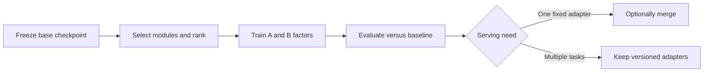

# LoRA (Low-Rank Adaptation)
TL;DR: LoRA freezes a pretrained weight matrix and learns a low-rank additive update, reducing trainable parameters while keeping adaptation capacity dependent on rank, target modules, and data.

## Prerequisites

Understand fine-tuning as gradient-based adaptation of pretrained weights and know basic matrix multiplication. This lesson covers LoRA for transformer linear layers; QLoRA additionally quantizes the frozen base weights to reduce memory use.

## Learning Outcomes

- Derive the LoRA update and count its trainable parameters for a linear layer.
- Explain how rank, scaling, target modules, and optimizer state affect cost and capacity.
- Compare adapter training and serving against full fine-tuning for a defined task.
- Diagnose a frozen-weight, target-module, scaling, or merge error from a small test.

## Core Intuition

Suppose a pretrained linear layer uses weight matrix `W ∈ R^(d_out×d_in)`. Full fine-tuning learns a change `ΔW` with `d_out × d_in` entries. LoRA instead constrains the change to a product of two smaller matrices: `ΔW = B A`, where `A ∈ R^(r×d_in)` and `B ∈ R^(d_out×r)`, with rank `r` much smaller than the layer dimensions. The effective weight is `W' = W + sBA`; the pretrained `W` is frozen while `A` and `B` are trained.

The analogy is describing a large change using a small set of reusable directions. It can work well when the task update is representable in a low-dimensional subspace, but that is an empirical assumption, not a theorem that every fine-tuning update is low rank. A small rank limits capacity and may underfit. Increasing rank raises parameter count and optimizer state; it does not guarantee a quality gain. Results depend on the task, data, base model, target modules, and training recipe.

## How It Works

For a layer with input width `d_in` and output width `d_out`, full matrix training uses `d_in d_out` weights. LoRA uses `r(d_in + d_out)` parameters. For a square `d × d` layer the fraction is `2r/d`; for example, when `d=4096` and `r=8`, that matrix's adapter has 65,536 parameters versus 16,777,216 entries in `W` (about 0.39%). This is a per-layer comparison, not a universal whole-model trainable percentage. Biases, embeddings, output heads, and selected modules affect the total.

Many implementations scale the update as `s = α/r`, with initialization chosen so the initial update is zero or small. The frozen layer computes `Wx + sB(Ax)`. A common configuration targets attention projections, but some tasks benefit from adapting feed-forward projections or other linear layers. Target names differ across architectures; verify the actual modules and trainable-parameter list instead of trusting a copied configuration. Initialization, dropout, precision, and optimizer settings are implementation details to pin with the experiment.

During training, gradients flow through the frozen computation to the adapter factors, but the base weights are not updated. Optimizer states are therefore needed mainly for adapter parameters, though activation memory and base-model weights remain important. LoRA reduces trainable state; it does not make a large model's forward/backward activations free. Quantizing the base weights as in QLoRA can reduce base-weight memory further, while introducing quantization and numerical considerations.

At inference, an adapter may remain separate, adding the low-rank computation at each targeted layer, or be merged by adding `sBA` to `W` and saving a derived checkpoint. Merging removes the adapter branch for that checkpoint but loses the ability to switch adapters without loading another base/merged variant. Separate adapters support reuse of one base across tasks, with adapter storage, routing, batching, and concurrency costs. Benchmark the intended serving mode rather than assuming zero overhead.

### Workflow Flowchart



## Trade-offs

| Choice | Advantage | Cost or risk | Decision evidence |
|---|---|---|---|
| Lower rank | Smaller adapter and optimizer state | May lack capacity for target behavior | Validation performance versus rank under same recipe |
| Higher rank | More adaptation capacity | More memory, training state, and overfit risk | Improvement on held-out task slices, not training loss alone |
| Attention-only targets | Compact and common baseline | May miss changes needing feed-forward adaptation | Ablation by target-module set |
| Separate adapter | Switch tasks while reusing base weights | Routing and runtime adapter overhead | Concurrency, latency, and adapter-count benchmarks |
| Merged checkpoint | Simple fixed-model inference path | New artifact per adapter; cannot hot-swap | Deployment simplicity versus model duplication |

Rank and target modules should be tuned as experimental variables. Keep data, base checkpoint, steps, and evaluation fixed while comparing a small set of configurations. Report trainable parameter count, peak memory, throughput, and target/regression metrics. Avoid claims such as “rank 8 is the default” or “LoRA always matches full tuning”: they obscure the relevant task and deployment boundary. Compare against full fine-tuning when feasible or a strong existing baseline, and include several seeds if run-to-run variation affects the decision.

## Implementation

This standard-library example computes the low-rank update for a tiny matrix and checks the effective linear transformation. It shows the algebra without a deep-learning dependency.

```python
def matmul(a, b):
    return [[sum(x * y for x, y in zip(row, col))
             for col in zip(*b)] for row in a]

def add(a, b):
    return [[x + y for x, y in zip(ar, br)] for ar, br in zip(a, b)]

W = [[1.0, 0.0], [0.0, 1.0]]
A = [[1.0, 0.0]]          # rank r=1, shape (1, 2)
B = [[0.5], [1.0]]        # shape (2, 1)
scale = 2.0
delta = [[scale * x for x in row] for row in matmul(B, A)]
W_merged = add(W, delta)
x = [[2.0], [3.0]]
assert matmul(W_merged, x) == [[4.0], [7.0]]
assert len(A) * len(A[0]) + len(B) * len(B[0]) == 4
```

In a framework implementation, verify that base parameters have `requires_grad=False`, adapter parameters do have gradients, and the configured target modules were actually found. Compare separate-adapter and merged outputs within numeric tolerance. These checks catch common wiring mistakes before a large training run.

## Failure Modes

- **Base weights accidentally trainable:** optimizer updates the full model and erases the expected memory benefit. Assert the trainable parameter names/count before training and inspect gradient presence after one step.
- **No target layers matched:** a configuration names modules from another architecture and trains no useful adapter. Print matched module names and fail fast if the expected count is zero.
- **Rank too constrained or unnecessarily large:** low rank underfits; high rank raises state and can overfit. Compare held-out task metrics and train/validation gap across controlled ranks.
- **Incorrect scale or merge:** omitting or double-applying `α/r` changes the learned function. Test outputs before and after merge on fixed inputs and compare within precision-aware tolerance.
- **Adapter/checkpoint mismatch:** loading an adapter against a different base revision or tokenizer can produce invalid behavior. Store base model revision, tokenizer, target modules, rank, and configuration with the adapter.
- **Assuming parameter savings equal total memory savings:** base weights, activations, sequence length, and temporary buffers remain. Measure peak memory and throughput on the target hardware; consider QLoRA or sequence/activation techniques when those dominate.
- **Adapter proliferation:** many adapters complicate routing, batching, versioning, and rollback. Measure the actual task portfolio and establish lifecycle and compatibility rules before deploying dynamic selection.

## Interview Quick Reference

| Question | Answer |
|---|---|
| What is the LoRA update? | Freeze `W` and learn `B A`, where the inner rank `r` is small; commonly scale the update by `α/r`. |
| How many parameters does one adapter use? | `r(d_in + d_out)` for a linear layer, compared with `d_in d_out` full weights. The total depends on all targeted layers and any other trainable parameters. |
| How do you select rank? | Run controlled validation experiments across a small rank range and report quality, memory, and throughput. Rank is a capacity/cost choice, not a universal constant. |
| Debugging follow-up: LoRA training is no cheaper than full tuning. | Check frozen base parameters, matched targets, optimizer parameter groups, activation/base-weight memory, and sequence length; then measure peak memory rather than infer it from trainable percentage. |

## Related Concepts

- [Fine-tuning](04-finetuning.md) — the broader adaptation objective.
- [Parameter-Efficient Fine-tuning](11-parameter-efficient-finetuning.md) — LoRA alongside other PEFT approaches.
- [Quantization](../../ml/concepts/quantization.md) — quantization is combined with LoRA in QLoRA.
- [Adapters](09-adapters.md) — an alternative parameter-efficient architecture.
- [LoRA notebook](../notebooks/08-lora.ipynb) — paired walkthrough.
- [LoRA practice](../interview-prep/curriculum-practice.md#lora-low-rank-adaptation) — manifest-linked assessment.
- [Original LoRA paper deep dive](../../papers/nlp/concepts/05-lora.md) — derivation and experiments.

## Resources

- [LoRA: Low-Rank Adaptation of Large Language Models](https://arxiv.org/abs/2106.09685)
- [QLoRA: Efficient Finetuning of Quantized LLMs](https://arxiv.org/abs/2305.14314)
- [Hugging Face PEFT documentation](https://huggingface.co/docs/peft/)
- [Hugging Face PEFT source repository](https://github.com/huggingface/peft)
- [Lightning: LoRA fine-tuning overview](https://lightning.ai/pages/community/tutorial/lora-fine-tuning/)

## Concept Relationships

LoRA is a parameter-efficient way to perform supervised or preference-based adaptation; QLoRA combines it with a quantized frozen base. Notebook: [08-lora.ipynb](../notebooks/08-lora.ipynb). Practice: [LoRA questions](../interview-prep/curriculum-practice.md#lora-low-rank-adaptation).

## Interview Questions

**When would you choose an adapter over a merged model?**

Keep adapters separate when the same base must serve multiple independently versioned tasks and the runtime can route and batch them efficiently. Merge when one adapter is fixed for a deployment and a simpler inference graph is valuable. Benchmark both paths with realistic concurrency, and preserve the base revision and adapter artifact so a merged model can be reproduced or rolled back.
