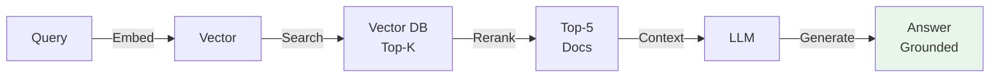
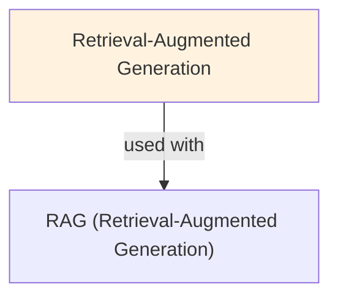

# Retrieval-Augmented Generation (RAG)

Treat retrieval-augmented generation (rag) as a controlled decision in a larger system rather than a magic capability.

## Prerequisites

Familiarity with rag. This note focuses on the LLM-specific mechanism and its engineering selection boundary.

## Learning Outcomes

- Explain the mechanism and assumptions behind retrieval-augmented generation (rag).
- Compare its main alternative using task quality and one operational cost.
- Diagnose a failure using a metric or example tied to retrieval-augmented generation (rag).

## Core Intuition

Treat retrieval-augmented generation (rag) as a controlled decision in a larger system rather than a magic capability. State the goal, allowed inputs, permitted actions, and stopping condition first. Then trace how information changes at each step. This makes the design reviewable: a teammate can inspect what evidence led to a decision, what the system did, and whether the result met the task contract. The central engineering question is whether the extra mechanism improves outcomes enough to justify its additional complexity and operational cost.

LLMs hallucinate because they only know what's in their weights (frozen at training). RAG is like giving them a reference library: retrieve relevant passages first, then generate. Cheap, effective, updatable without retraining.

## How It Works

A practical design starts with a task boundary and an observable success criterion. The orchestrator collects the relevant state, selects the next operation, validates its inputs, and records the result. It then checks whether the goal is complete or whether another bounded step is justified. Keep the state passed between steps explicit and small; include only data that affects the decision. Separate policy from execution so a decision can be inspected before it causes an external effect. When possible, make operations idempotent and attach a stable identifier so retries do not duplicate work.

For retrieval-augmented generation (rag), the important implementation detail is to make the decision point testable. Define the expected input shape, valid output shape, allowed resource budget, timeout, and fallback behavior. Record a trace containing the request identifier, chosen operation, outcome category, and duration, while excluding secrets and unnecessary personal data. A good trace supports diagnosis without requiring access to hidden model reasoning. Use representative examples and counterexamples to measure success, then inspect disagreements and boundary cases before increasing autonomy.

**1. Indexing Phase (Offline):**
- Break documents into chunks (paragraphs, sentences, fixed tokens)
- Embed chunks using a dense encoder (e.g., BERT, Sentence-Transformers)
- Store embeddings + text in a vector database (Pinecone, Weaviate, FAISS)

**2. Retrieval Phase (At Query Time):**
```
Query → Embed query → Find top-k chunks by cosine similarity → Retrieve text
```
- User query: "What is the capital of France?"
- Embed: dense vector
- Search: find k nearest embedding vectors (ANN search)
- Retrieve: text of k closest matches

**3. Generation Phase:**
- Combine retrieved context with original query
- Prompt template:
  ```
  Context: {retrieved_text}
  Question: {query}
  Answer: {LLM generates}
  ```
- LLM generates conditioned on context

**Example Flow:**
```
User: "How many employees does Acme Corp have?"
  ↓ [Embed query]
  ↓ [Search vector DB for "Acme Corp employees"]
  ↓ [Top result: "As of Q3 2024, Acme Corp employs 5,000 people"]
  ↓ [Prompt LLM: Context + Query]
  → LLM: "Acme Corp has 5,000 employees as of Q3 2024."
```

### Workflow Flowchart



## Trade-offs

| Approach | Strength | Cost or risk | Choose when |
|---|---|---|---|
| Direct, single-step response | Lowest latency and simplest control path | Cannot adapt after new evidence | The task is bounded and context already contains needed facts |
| Retrieval-Augmented Generation (RAG) | Can improve task completion by making the relevant process explicit | More state, integration points, and failure paths to operate | Evaluation shows a repeatable gain for the target workload |
| Human review or deterministic workflow | Clear accountability and predictable policy enforcement | Slower and may require manual capacity | Errors have high impact or policy requires approval |

Compare alternatives on the same task set. Measure end-to-end task success and constraint violations alongside p50/p95 latency and cost per completed task. Do not count a call as successful merely because it returned valid syntax; verify that the result satisfies the user-facing task and all policy constraints.

## Implementation

The following small Python scaffold makes a bounded decision visible and rejects invalid results before they can influence later steps:

```python
def run_step(decide, state, allowed_actions, max_steps=3):
    trace = []
    for step in range(max_steps):
        choice = decide(state)
        if choice not in allowed_actions:
            return {"ok": False, "reason": "invalid_action", "trace": trace}
        result = allowed_actions[choice].__call__(state)
        trace.append({"step": step, "action": choice, "result": result})
        state = {**state, "last_result": result}
        if result.get("done") is True:
            return {"ok": True, "state": state, "trace": trace}
    return {"ok": False, "reason": "step_limit", "trace": trace}
```

In production, validate schemas at the boundary, set per-operation timeouts, redact sensitive trace fields, and make the step limit configurable by task risk. Keep deterministic checks outside the model call so malformed choices and unsafe actions fail closed.

## Failure Modes

- **Unclear task boundary:** the system performs extra work or returns an untestable result. Diagnose by comparing traces with the task contract; mitigate with explicit completion criteria and a deterministic stop check.
- **Invalid or stale state:** later decisions rely on missing, malformed, or outdated evidence. Diagnose with schema and freshness checks; mitigate by validating state at each boundary and refreshing authoritative data.
- **Unbounded retries or work:** cost and latency grow without improving completion. Diagnose by step-count and timeout distributions; mitigate with budgets, backoff for transient errors, and a terminal failure state.
- **Misleading evaluation:** aggregate success hides harmful edge cases. Diagnose by slicing results by task type and impact; mitigate with held-out adversarial cases and human review for high-impact outcomes.

## Interview Quick Reference

| Question | Strong answer | Follow-up probe |
|---|---|---|
| What problem does retrieval-augmented generation (rag) solve? | It addresses a stated task limitation and should be justified by measured end-to-end improvement. | What baseline would you compare against? |
| How would you keep it reliable? | Validate boundaries, bound resources, log useful traces, and define recovery behavior. | How would you debug a regression? |
| When would you avoid it? | When a simpler method meets the quality target or added complexity exceeds the value. | Which metric changes that decision? |

## Related Concepts

This lesson connects to llm/rag. It also informs the downstream topics that consume its outputs: schema validation, observability, evaluation, and safe recovery. When designing a system, map these dependencies explicitly so a failure can be localized to the decision, execution, or verification stage.

## References

- [OpenAI API documentation](https://platform.openai.com/docs/guides/function-calling)
- [NIST AI Risk Management Framework](https://www.nist.gov/itl/ai-risk-management-framework)

## Topic-specific notes

| Aspect | Naive Generation | RAG | Fine-Tuning |
|--------|------------------|-----|------------|
| Hallucination risk | High | Low | Medium |
| Knowledge freshness | Training date | Real-time | Requires retraining |
| Domain knowledge | Needs training | Zero-shot on docs | Requires labeled data |
| Latency | Fast | Slow (retrieval) | Fast |
| Cost (training) | Expensive | Cheap | Medium |
| Customization | Not possible | Easy (swap docs) | Requires retraining |

**Chunk Size Trade-offs:**
- Small chunks (50-100 tokens): precise, higher retrieval noise
- Medium chunks (256-512 tokens): balanced
- Large chunks (1k+ tokens): context-rich but may include irrelevant info

**Retrieval Quality:**
- Sparse (BM25): fast, lexical match only, brittle
- Dense (embeddings): slower, semantic match, robust
- Hybrid: combine both, best results

## Topic-specific notes

- **Low retrieval quality:** Embedding model mismatch (query ≠ document domain), bad chunk boundaries, insufficient k
- **Context length:** Retrieved text + query + generation can exceed model's context window. Manage carefully.
- **Hallucinating while citing:** LLM may cite retrieved docs while generating false info. Add grounding metrics.
- **Retrieval latency:** Dense embeddings + ANN search can be slow. Optimize with approximate methods.
- **Chunk boundary artifacts:** Cutting mid-sentence loses context. Use overlap or intelligent segmentation.
- **No re-ranking:** Raw retrieval scores may rank documents poorly. Add re-ranker (cross-encoder) to reorder top-k.
- **Forgetting to update docs:** If docs change but embeddings don't, stale information. Version and re-embed.

## Topic-specific notes

```python
from sentence_transformers import SentenceTransformer
import numpy as np
from sklearn.metrics.pairwise import cosine_similarity

# Mock document store
documents = [
    "Paris is the capital of France.",
    "France is in Western Europe.",
    "The Eiffel Tower is in Paris.",
    "London is the capital of the UK.",
    "Madrid is the capital of Spain.",
]

# 1. Indexing: embed documents
encoder = SentenceTransformer('all-MiniLM-L6-v2')
doc_embeddings = encoder.encode(documents)  # (5, 384)

# 2. Query and retrieve
query = "What is the capital of France?"
query_emb = encoder.encode(query)  # (384,)
similarities = cosine_similarity([query_emb], doc_embeddings)[0]
top_k = np.argsort(-similarities)[:2]  # Top 2

retrieved = [documents[i] for i in top_k]
print("Retrieved context:")
for doc in retrieved:
    print(f"  - {doc}")

# 3. Generation (simulate with template)
context = "\n".join(retrieved)
prompt = f"""Context: {context}
Question: {query}
Answer:"""

# In practice, call your LLM:
# response = llm.generate(prompt)
print(f"\nPrompt to LLM:\n{prompt}")

# Expected LLM response:
# "Paris is the capital of France."
```

## Topic-specific notes

| Question | What to say |
|---|---|
| "What is RAG?" | Retrieve relevant documents, feed to LLM, generate grounded answer. |
| "Why RAG vs fine-tuning?" | RAG: cheap, updatable, zero-shot. Fine-tuning: higher accuracy, slower to update, needs data. |
| "How to handle latency?" | Use approximate ANN (HNSW, IVF), cache embeddings, batch queries, add re-ranker for quality. |
| "Chunk size?" | 256-512 tokens balanced. Smaller for precision, larger for context. |
| "Retrieval quality low?" | Check embedding model fit to domain, chunk segmentation, k value. Try dense + BM25 hybrid. |
| "How to mitigate hallucination?" | Enforce citations to retrieved text, use grounding metrics, add re-ranker. |

## Real-World Examples

### Enterprise RAG for Support
50K support docs. Query: retrieve top-5 docs, generate answer. User satisfaction: 70% (basic) → 90% (RAG). Reduced support tickets by 35%.

### Medical RAG
50K medical papers. Doctor input: patient symptoms. RAG retrieves literature, LLM synthesizes. Not for diagnosis (needs human), but research support.

## Topic-specific notes

**Q: How do you measure RAG pipeline quality end-to-end?**
A: Use RAGAS metrics: faithfulness (are claims in the answer supported by retrieved context?), answer relevance (does the answer address the question?), context precision (are retrieved chunks relevant?), context recall (are all needed chunks retrieved?). Also measure end-to-end exact match or F1 on a test set with labeled answers. Separately measure retrieval quality (recall@k) to isolate retrieval vs. generation failures.

**Q: What is the "lost in the middle" problem and how does it affect RAG?**
A: Models pay less attention to information in the middle of long contexts—performance is highest when relevant information is at the beginning or end. For RAG with 10+ retrieved chunks, the most relevant chunk should be placed first (or last) rather than in the middle. Reranking helps by promoting the most relevant chunks. Alternatively, limit to 3-5 chunks and accept lower recall but better utilization.

**Q: How do you handle questions that the retrieved documents don't answer?**
A: The model should acknowledge when it cannot find the answer in the provided context, rather than hallucinating. Enforce this with explicit prompt instructions: "Only answer using the provided context. If the context doesn't contain the answer, say 'I don't have enough information.'" Additionally, train or prompt a confidence classifier to detect when retrieved context is insufficient. Never let the model silently mix retrieved context with parametric knowledge.

**Q: What is HyDE (Hypothetical Document Embeddings) and when does it help?**
A: HyDE generates a hypothetical document that would answer the query, then uses that document's embedding for retrieval instead of the query embedding. This helps when query and document are in very different linguistic styles (short sparse query vs. dense paragraph). HyDE improves recall for complex, multi-faceted queries by generating a "target document" that better matches the embedding space of real documents. Adds one LLM call overhead per query.

**Q: How do you keep the vector database synchronized with a frequently-updated document corpus?**
A: Use an incremental update strategy: hash document content, compare with stored hashes, only re-embed changed documents. Use streaming pipelines (Kafka, Kinesis) to process document changes in near-real-time. Set document TTLs for time-sensitive content. For large corpora with frequent updates, partition by recency—maintain a "recent" index updated frequently and a "stable" index updated less often, search both and merge results.

**Q: What are the latency components of a RAG pipeline and how do you optimize each?**
A: (1) Query embedding: 5-20ms—use a small embedding model (all-MiniLM-L6) or cache query embeddings. (2) Vector search: 5-50ms depending on index size—use HNSW index, quantize vectors, reduce search dimensions. (3) LLM generation: 100-2000ms—use streaming to reduce perceived latency, cache common query responses, use smaller models for simple queries. Total target: <500ms for most RAG applications. Measure each component separately to identify bottlenecks.

## Topic-specific notes

- [Embeddings](02-embeddings.md) — how documents are encoded for retrieval
- [Semantic Search](21-semantic-search.md) — the retrieval component of RAG
- [Vector Databases](20-vector-databases.md) — where embeddings are stored and searched
- [Prompting](12-prompting.md) — structuring the prompt with retrieved context
- [Context Window](25-context-window.md) — managing size of retrieved context + query

## Resources

- [RAG Paper: Retrieval-Augmented Generation for Knowledge-Intensive NLP Tasks](https://arxiv.org/abs/2005.11401)
- [LangChain RAG Tutorial](https://python.langchain.com/docs/use_cases/question_answering/)
- [Pinecone: RAG Explained](https://www.pinecone.io/learn/retrieval-augmented-generation/)
- [HuggingFace: RAG Model](https://huggingface.co/docs/transformers/model_doc/rag)

## Concept Relationships



## Interview Questions

**Q: What's RAG and how does it reduce hallucinations?**
*A: RAG: retrieve documents, feed as context, generate answer grounded in retrieved docs. Without RAG: model generates from memory (hallucinations). With RAG: facts grounded in documents. Hallucination rate: 30-50% lower.*

**Q: How do you structure a RAG pipeline?**
*A: 1) Index: chunk docs, embed, store in vector DB. 2) Retrieve: embed query, get top-k docs. 3) Rerank (optional): cross-encoder scores. 4) Generate: LLM + docs → answer. Latency: retrieval 50ms + ranking 50ms + generation 1000ms.*

**Q: What's dense vs sparse retrieval?**
*A: Dense: embeddings (semantic, slow). Sparse: keywords (BM25, fast). Hybrid: both combined. Dense finds 'good service' for 'satisfied', sparse misses without keyword overlap. Use hybrid for best results.*

**Q: When should you use reranking?**
*A: Retrieval top-20 candidates. Reranker: scores all 20. Cost: +50-100ms. Gain: +5-10% accuracy. Worth if: quality matters, latency allows.*

**Q: How do you handle knowledge base drift?**
*A: Documents change, become stale. Solutions: 1) Periodic reindexing (cheap). 2) TTL (auto-expire old docs). 3) Versioning (keep history). Most: combine periodic reindex + TTL.*
