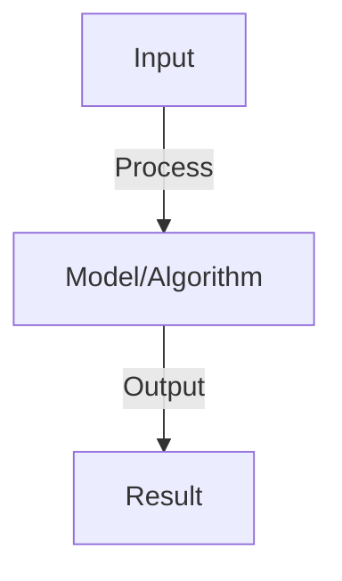

# Vision Transformers (ViT)

Patch size controls the ViT sequence length and therefore both spatial detail and quadratic attention cost.

## Prerequisites

Understand transformer inputs, tensor shapes, and how to evaluate a model on held-out data. This lesson narrows that background to the mechanism and decisions specific to vision transformers (vit).

## Learning Outcomes

- Explain the central mechanism and identify its key inputs and outputs.
- Compare at least two design choices using a quality measure and an operational cost.
- Diagnose a failure by selecting a workload slice and testing the assumption it violates.

## Core Intuition

Apply transformer architecture to computer vision by dividing images into patches and treating them as sequences

Patch size controls the ViT sequence length and therefore both spatial detail and quadratic attention cost. A reliable design begins with a simple baseline and makes the specialized method earn its added complexity through measured improvement. Keep the evaluation split and serving constraints fixed so the comparison isolates the design decision.

## How It Works

1. Divide image into fixed patches (16×16 pixels)
2. Flatten patches into vectors and linearly project to embedding dimension
3. Add positional embeddings (absolute position of each patch)
4. Pass through transformer encoder stack
5. Use [CLS] token embedding for image classification
6. Compare: ViT vs CNN receptive fields, ViT requires more data, ViT scales better



A small ViT experiment should compare patch sizes at a fixed image resolution and report accuracy together with token count and memory. Compare alternatives at a fixed input distribution and record both quality and system cost. For image models, vary resolution and patch size; for fusion, vary which modalities are available; for security, exercise allowed and denied actions; for retrieval, separate candidate generation from ranking. These controls make it possible to tell whether a change fixes the intended bottleneck or only moves it.

A useful experiment includes a baseline, a changed condition, and a deliberately difficult case. Use deterministic synthetic examples first to validate logic, then a held-out realistic slice to estimate task impact. Report uncertainty or repeat runs when training randomness can change the result.

## Trade-offs

| Design | Benefit | Cost or risk | Decision signal |
|---|---|---|---|
| Unconstrained baseline | Keeps the largest set of interactions or evidence | Highest memory, compute, or input burden | Use while the workload fits and quality is the priority |
| Structured method | Bounds a specific resource or failure path | May exclude useful cases | Use when workload structure justifies the constraint |
| Learned or approximate method | Can adapt behavior to the task | Adds estimation error and tuning sensitivity | Require slice-level quality checks |
| Modular fallback | Limits blast radius and supports missing inputs | Adds routing or orchestration work | Use when inputs or permissions vary by request |

## Implementation

The following dependency-light check captures one invariant for the topic. It is a logic check, not a claim of end-to-end model performance.

```python
patch_count = (image_size // patch_size) ** 2
assert patch_count == 196
```

For a full experiment, keep a control implementation and record input shape, data split, model version, batch policy, hardware, and measurement method. Measure warm and steady-state latency separately where compilation or caching is involved. A measured result should state the exact workload and include quality; a microbenchmark cannot establish user-facing benefit by itself.

## Failure Modes

- Patch size is reduced and attention memory spikes; measure tokens and peak memory. Diagnose by logging the topic-specific signal and comparing it with the expected input contract.
- The training set is small; compare transfer learning or a CNN baseline. Build a targeted edge case and check whether the failure is systematic across a meaningful slice.
- Resolution differs at inference; resize and interpolate positional embeddings deliberately. Compare against the baseline and monitor the affected quality or tail-cost metric after rollout.

## Interview Quick Reference

| Question | Expected answer |
|---|---|
| What is the design’s central mechanism? | Patch size controls the ViT sequence length and therefore both spatial detail and quadratic attention cost. Name its assumptions and the resource or behavior it changes. |
| What alternative would you evaluate? | Compare the unconstrained baseline with a structured or modular approach on the same task and budget. |
| How would you investigate a regression? | Slice the affected workload, test the violated assumption, and compare with a control path. |

**Debugging follow-up:** Patch size is reduced and attention memory spikes; measure tokens and peak memory. What would you log, what held-out case would you add, and which metric would trigger rollback?

## Related Concepts

Read [attention optimization](24-attention-optimization.md), [evaluation](32-evaluation.md), and the [associated notebook](../notebooks/33-vision-transformers.ipynb). Drill: [practice question](../interview-prep/curriculum-practice.md#vision-transformers-vit).

References: [primary source](https://arxiv.org/abs/2010.11929); [technical reference](https://huggingface.co/docs/transformers/model_doc/vit).

### Existing interview notes

**Q: Why divide images into patches instead of processing pixels directly?**
A: Patches reduce sequence length: 224×224 image = 196 patches vs 50K pixels. Transformers have O(n²) complexity, so patches are essential. Also enables positional embeddings.

**Q: How does ViT compare to CNNs?**
A: ViT: no inductive bias (worse small-data), requires more training data, scales better to large datasets, more interpretable attention. CNN: inductive bias (shift/scale invariance), data-efficient, good for small images.

**Q: What is the [CLS] token in ViT?**
A: Learned token prepended to patch sequence, similar to BERT. Its final representation is used as image embedding for classification. Learned end-to-end via supervised training.

**Q: How does positional encoding work in ViT?**
A: Learned absolute positional embeddings (no sinusoidal like NLP). Added to patch embeddings before transformer. Why learned? ViT authors found it matched sinusoidal, so learned is simpler.

**Q: Can ViT process images of different sizes?**
A: No, fixed input size by design. To handle different sizes: resize, crop, or retrain. Some methods use adaptive pooling or dynamic patch sizes, but vanilla ViT needs fixed size.

The measurements should be repeated on workload slices where the named failure is plausible; aggregate averages can conceal both quality loss and resource spikes.
