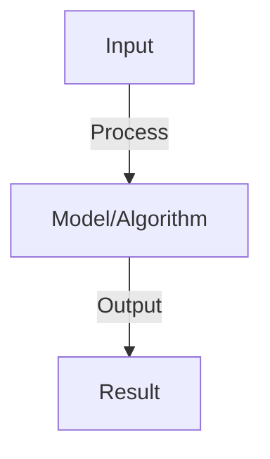

# Multimodal Fusion

Fusion is only meaningful when modality features refer to the same example and their missingness is represented explicitly.

## Prerequisites

Understand transformer inputs, tensor shapes, and how to evaluate a model on held-out data. This lesson narrows that background to the mechanism and decisions specific to multimodal fusion.

## Learning Outcomes

- Explain the central mechanism and identify its key inputs and outputs.
- Compare at least two design choices using a quality measure and an operational cost.
- Diagnose a failure by selecting a workload slice and testing the assumption it violates.

## Core Intuition

Combine image and text representations in a shared embedding space for tasks like image captioning, visual question answering, and image-text retrieval

Fusion is only meaningful when modality features refer to the same example and their missingness is represented explicitly. A reliable design begins with a simple baseline and makes the specialized method earn its added complexity through measured improvement. Keep the evaluation split and serving constraints fixed so the comparison isolates the design decision.

## How It Works

1. Encode images with CNN/ViT → image embeddings (2048D)
2. Encode text with BERT/GPT → text embeddings (768D)
3. Project both to shared dimension (e.g., 256D)
4. Compute similarity: cosine distance in shared space
5. Contrastive learning: pull matching pairs close, push mismatched pairs apart
6. Applications: CLIP (image-text matching), BLIP (captioning), LLaVA (vision-language models)



Compare concatenation, gated fusion, and late score fusion on paired and missing-modality validation slices. Compare alternatives at a fixed input distribution and record both quality and system cost. For image models, vary resolution and patch size; for fusion, vary which modalities are available; for security, exercise allowed and denied actions; for retrieval, separate candidate generation from ranking. These controls make it possible to tell whether a change fixes the intended bottleneck or only moves it.

A useful experiment includes a baseline, a changed condition, and a deliberately difficult case. Use deterministic synthetic examples first to validate logic, then a held-out realistic slice to estimate task impact. Report uncertainty or repeat runs when training randomness can change the result.

## Trade-offs

| Design | Benefit | Cost or risk | Decision signal |
|---|---|---|---|
| Unconstrained baseline | Keeps the largest set of interactions or evidence | Highest memory, compute, or input burden | Use while the workload fits and quality is the priority |
| Structured method | Bounds a specific resource or failure path | May exclude useful cases | Use when workload structure justifies the constraint |
| Learned or approximate method | Can adapt behavior to the task | Adds estimation error and tuning sensitivity | Require slice-level quality checks |
| Modular fallback | Limits blast radius and supports missing inputs | Adds routing or orchestration work | Use when inputs or permissions vary by request |

## Implementation

The following dependency-light check captures one invariant for the topic. It is a logic check, not a claim of end-to-end model performance.

```python
present = [True, False]
assert sum(present) == 1
```

For a full experiment, keep a control implementation and record input shape, data split, model version, batch policy, hardware, and measurement method. Measure warm and steady-state latency separately where compilation or caching is involved. A measured result should state the exact workload and include quality; a microbenchmark cannot establish user-facing benefit by itself.

## Failure Modes

- Audio and transcript timestamps drift; measure alignment error. Diagnose by logging the topic-specific signal and comparing it with the expected input contract.
- A modality is absent; evaluate the trained missing-input path. Build a targeted edge case and check whether the failure is systematic across a meaningful slice.
- Feature scales differ; normalize per modality before concatenation. Compare against the baseline and monitor the affected quality or tail-cost metric after rollout.

## Interview Quick Reference

| Question | Expected answer |
|---|---|
| What is the design’s central mechanism? | Fusion is only meaningful when modality features refer to the same example and their missingness is represented explicitly. Name its assumptions and the resource or behavior it changes. |
| What alternative would you evaluate? | Compare the unconstrained baseline with a structured or modular approach on the same task and budget. |
| How would you investigate a regression? | Slice the affected workload, test the violated assumption, and compare with a control path. |

**Debugging follow-up:** Audio and transcript timestamps drift; measure alignment error. What would you log, what held-out case would you add, and which metric would trigger rollback?

## Related Concepts

Read [attention optimization](24-attention-optimization.md), [evaluation](32-evaluation.md), and the [associated notebook](../notebooks/34-multimodal-fusion.ipynb). Drill: [practice question](../interview-prep/curriculum-practice.md#multimodal-fusion).

References: [primary source](https://arxiv.org/abs/1705.09406); [technical reference](https://huggingface.co/docs/transformers/tasks).

### Existing interview notes

**Q: What is the key insight in CLIP?**
A: Train on 400M image-text pairs with contrastive loss: similar pairs have high cosine similarity, dissimilar pairs have low. Results in aligned embedding space without labeled data.

**Q: How do you handle modality gaps?**
A: Modalities have different dimensionality and structure (image 2048D, text 768D). Solution: project to shared space (256D). Train end-to-end so projections are mutually aligned.

**Q: What's the difference between early fusion and late fusion?**
A: Early: concatenate features before processing (sensitive to modality differences). Late: process separately, combine at end (more modality-agnostic). ViLBERT uses late fusion for vision-language.

**Q: How do you evaluate multimodal models?**
A: Image-text retrieval: rank images for query, measure recall@k. Image captioning: BLEU/CIDEr scores. VQA: accuracy on questions. Use cross-modal metrics (retrieval) and task-specific metrics.

**Q: What is the role of negative sampling in contrastive learning?**
A: Without negatives, model could collapse (all embeddings identical). Negatives force discrimination: positive pair distance < negative pair distance. Batch size matters: larger batches = more negatives = better learning.

The measurements should be repeated on workload slices where the named failure is plausible; aggregate averages can conceal both quality loss and resource spikes.

The missing-modality slice should be reported independently because an apparently strong average can hide a fallback path that rarely works.
Track availability before the fusion layer to distinguish sensor dropout from a model quality regression.
