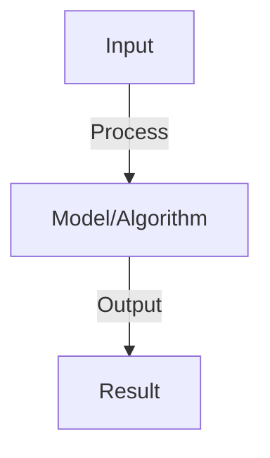

# Model Interpretability

An attribution score describes sensitivity under a chosen method and baseline; it does not by itself prove a causal explanation.

## Prerequisites

Understand transformer inputs, tensor shapes, and how to evaluate a model on held-out data. This lesson narrows that background to the mechanism and decisions specific to model interpretability.

## Learning Outcomes

- Explain the central mechanism and identify its key inputs and outputs.
- Compare at least two design choices using a quality measure and an operational cost.
- Diagnose a failure by selecting a workload slice and testing the assumption it violates.

## Core Intuition

Understand what features and patterns neural networks learn by visualizing attention, probing hidden representations, and analyzing decision boundaries

An attribution score describes sensitivity under a chosen method and baseline; it does not by itself prove a causal explanation. A reliable design begins with a simple baseline and makes the specialized method earn its added complexity through measured improvement. Keep the evaluation split and serving constraints fixed so the comparison isolates the design decision.

## How It Works

1. Attention visualization: show which tokens attend to which (heatmaps)
2. Feature attribution: which input features contributed most to prediction
   - Gradient-based: ∂output/∂input (saliency maps)
   - Perturbation: remove tokens, measure output change
3. Probing: train classifier on hidden representations to extract information
4. Representation analysis: PCA/t-SNE on embeddings to visualize clusters
5. Layer-wise relevance propagation: trace predictions back through layers



Compare explanations for stability across small input changes and test claims with interventions or counterfactual examples. Compare alternatives at a fixed input distribution and record both quality and system cost. For image models, vary resolution and patch size; for fusion, vary which modalities are available; for security, exercise allowed and denied actions; for retrieval, separate candidate generation from ranking. These controls make it possible to tell whether a change fixes the intended bottleneck or only moves it.

A useful experiment includes a baseline, a changed condition, and a deliberately difficult case. Use deterministic synthetic examples first to validate logic, then a held-out realistic slice to estimate task impact. Report uncertainty or repeat runs when training randomness can change the result.

## Trade-offs

| Design | Benefit | Cost or risk | Decision signal |
|---|---|---|---|
| Unconstrained baseline | Keeps the largest set of interactions or evidence | Highest memory, compute, or input burden | Use while the workload fits and quality is the priority |
| Structured method | Bounds a specific resource or failure path | May exclude useful cases | Use when workload structure justifies the constraint |
| Learned or approximate method | Can adapt behavior to the task | Adds estimation error and tuning sensitivity | Require slice-level quality checks |
| Modular fallback | Limits blast radius and supports missing inputs | Adds routing or orchestration work | Use when inputs or permissions vary by request |

## Implementation

The following dependency-light check captures one invariant for the topic. It is a logic check, not a claim of end-to-end model performance.

```python
scores = [0.2, 0.8]
assert max(scores) == 0.8
```

For a full experiment, keep a control implementation and record input shape, data split, model version, batch policy, hardware, and measurement method. Measure warm and steady-state latency separately where compilation or caching is involved. A measured result should state the exact workload and include quality; a microbenchmark cannot establish user-facing benefit by itself.

## Failure Modes

- Correlated inputs split or hide attribution; test grouped perturbations. Diagnose by logging the topic-specific signal and comparing it with the expected input contract.
- A tiny input edit changes the explanation; quantify explanation stability. Build a targeted edge case and check whether the failure is systematic across a meaningful slice.
- A probe predicts a feature that the model does not use; validate with intervention. Compare against the baseline and monitor the affected quality or tail-cost metric after rollout.

## Interview Quick Reference

| Question | Expected answer |
|---|---|
| What is the design’s central mechanism? | An attribution score describes sensitivity under a chosen method and baseline; it does not by itself prove a causal explanation. Name its assumptions and the resource or behavior it changes. |
| What alternative would you evaluate? | Compare the unconstrained baseline with a structured or modular approach on the same task and budget. |
| How would you investigate a regression? | Slice the affected workload, test the violated assumption, and compare with a control path. |

**Debugging follow-up:** Correlated inputs split or hide attribution; test grouped perturbations. What would you log, what held-out case would you add, and which metric would trigger rollback?

## Related Concepts

Read [attention optimization](24-attention-optimization.md), [evaluation](32-evaluation.md), and the [associated notebook](../notebooks/35-model-interpretability.ipynb). Drill: [practice question](../interview-prep/curriculum-practice.md#model-interpretability).

References: [primary source](https://arxiv.org/abs/1602.04938); [technical reference](https://arxiv.org/abs/1703.01365).

### Existing interview notes

**Q: What can attention heatmaps tell us?**
A: They show which tokens the model focuses on for a prediction. Not always interpretable (attention != explanation), but useful for debugging. Multi-head attention shows different patterns per head.

**Q: What is probing and how is it different from inspection?**
A: Probing: train a classifier on hidden representations to check if information exists. Inspection: look at activations directly. Probing is more rigorous: shows what a decoder can extract, not what the model actually uses.

**Q: What's the difference between saliency and attribution?**
A: Saliency: gradient ∂y/∂x (local linear approximation). Attribution: integrated gradients (path from baseline to input, sums gradients). Attribution more stable, saliency faster.

**Q: Can attention really explain model decisions?**
A: Not always. Attention is computed, but model may make decisions based on hidden computation before attention. Attention is correlated with important features but not causal. Use with caution.

**Q: How do you interpret embeddings from language models?**
A: PCA: reduce to 2D, look for clusters (synonyms close?). Nearest neighbors: find similar words. Probing classifiers: train on known properties (gender, tense). Combinations give best insight.

The measurements should be repeated on workload slices where the named failure is plausible; aggregate averages can conceal both quality loss and resource spikes.
