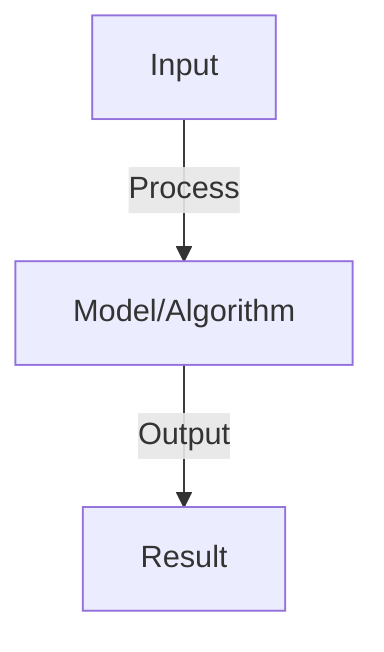

# Knowledge Distillation

Temperature-scaled teacher probabilities expose relative class preferences that a hard label discards.

## Prerequisites

Understand transformer inputs, tensor shapes, and how to evaluate a model on held-out data. This lesson narrows that background to the mechanism and decisions specific to knowledge distillation.

## Learning Outcomes

- Explain the central mechanism and identify its key inputs and outputs.
- Compare at least two design choices using a quality measure and an operational cost.
- Diagnose a failure by selecting a workload slice and testing the assumption it violates.

## Core Intuition

A master chess player coaching a student doesn't just say 'move the knight here.' Instead, they explain 'the knight move is good because it attacks three pieces while staying protected, and here's why that's stronger than the other moves I considered.' The student learns faster by understanding the master's reasoning. Knowledge distillation teaches student models the 'reasoning' of teacher models.

Temperature-scaled teacher probabilities expose relative class preferences that a hard label discards. A reliable design begins with a simple baseline and makes the specialized method earn its added complexity through measured improvement. Keep the evaluation split and serving constraints fixed so the comparison isolates the design decision.

## How It Works

1. Teacher model: large pre-trained model (175B GPT-3 or 70B Llama)
2. Student model: smaller model to be trained (7B, 3B, or 1B parameters)
3. Distillation loss: KL divergence between teacher and student logits
4. Temperature scaling: soften probability distributions for better learning
5. Data: teacher predictions on large corpus (unlabeled data OK)
6. Training: minimize L = α * student_loss + (1-α) * KL(teacher, student)
7. Result: student 70-90% of teacher performance at 10-100x efficiency



Compare a hard-label student against a student trained with softened teacher targets at matched parameter count. Compare alternatives at a fixed input distribution and record both quality and system cost. For image models, vary resolution and patch size; for fusion, vary which modalities are available; for security, exercise allowed and denied actions; for retrieval, separate candidate generation from ranking. These controls make it possible to tell whether a change fixes the intended bottleneck or only moves it.

A useful experiment includes a baseline, a changed condition, and a deliberately difficult case. Use deterministic synthetic examples first to validate logic, then a held-out realistic slice to estimate task impact. Report uncertainty or repeat runs when training randomness can change the result.

## Trade-offs

| Design | Benefit | Cost or risk | Decision signal |
|---|---|---|---|
| Unconstrained baseline | Keeps the largest set of interactions or evidence | Highest memory, compute, or input burden | Use while the workload fits and quality is the priority |
| Structured method | Bounds a specific resource or failure path | May exclude useful cases | Use when workload structure justifies the constraint |
| Learned or approximate method | Can adapt behavior to the task | Adds estimation error and tuning sensitivity | Require slice-level quality checks |
| Modular fallback | Limits blast radius and supports missing inputs | Adds routing or orchestration work | Use when inputs or permissions vary by request |

## Implementation

The following dependency-light check captures one invariant for the topic. It is a logic check, not a claim of end-to-end model performance.

```python
assert abs(sum([.6,.3,.1]) - 1.0) < 1e-9
```

For a full experiment, keep a control implementation and record input shape, data split, model version, batch policy, hardware, and measurement method. Measure warm and steady-state latency separately where compilation or caching is involved. A measured result should state the exact workload and include quality; a microbenchmark cannot establish user-facing benefit by itself.

## Failure Modes

- Student loses rare classes; inspect per-class recall, not only average accuracy. Diagnose by logging the topic-specific signal and comparing it with the expected input contract.
- Teacher errors are copied; filter or weight low-confidence targets. Build a targeted edge case and check whether the failure is systematic across a meaningful slice.
- Temperature is too low to reveal class similarity; sweep it on validation data. Compare against the baseline and monitor the affected quality or tail-cost metric after rollout.

## Interview Quick Reference

| Question | Expected answer |
|---|---|
| What is the design’s central mechanism? | Temperature-scaled teacher probabilities expose relative class preferences that a hard label discards. Name its assumptions and the resource or behavior it changes. |
| What alternative would you evaluate? | Compare the unconstrained baseline with a structured or modular approach on the same task and budget. |
| How would you investigate a regression? | Slice the affected workload, test the violated assumption, and compare with a control path. |

**Debugging follow-up:** Student loses rare classes; inspect per-class recall, not only average accuracy. What would you log, what held-out case would you add, and which metric would trigger rollback?

## Related Concepts

Read [attention optimization](24-attention-optimization.md), [evaluation](32-evaluation.md), and the [associated notebook](../notebooks/37-knowledge-distillation.ipynb). Drill: [practice question](../interview-prep/curriculum-practice.md#knowledge-distillation).

References: [primary source](https://arxiv.org/abs/1503.02531); [technical reference](https://huggingface.co/docs/transformers/tasks/distillation).

### Existing interview notes

**Q: Why does distillation work if student has fewer parameters?**
A: Teacher provides soft targets (probability distributions), not hard labels. These contain more information than one-hot labels. Student learns patterns, not memorizes. Similar to learning from expert rather than raw data.

**Q: How do you choose temperature in distillation?**
A: Higher temperature (T>1): soften probabilities, more information transfer but slower learning. Lower temperature (T<1): sharper probabilities, faster learning but less information. Typical range: T=3-20. Tune on validation set.

**Q: Can you distill an LLM to a much smaller model (10x smaller)?**
A: Possible but challenging: 90-95% performance loss acceptable for many tasks. Key: task-specific distillation (focus on target task, not general knowledge). Use intermediate-sized teacher (not largest), more training data, longer training.

**Q: What's better: distillation or quantization?**
A: Distillation: smaller model with fewer parameters (can run on CPU). Quantization: same size, fewer bits per weight (still large but faster). Can combine both. Distillation better for extreme size reduction, quantization better for speed.

**Q: How do you evaluate distillation?**
A: Measure: (1) student performance on task (accuracy, BLEU, etc.), (2) inference latency/memory, (3) training cost (time + compute). Compare: student alone vs distilled vs teacher. Report: accuracy-efficiency frontier.
