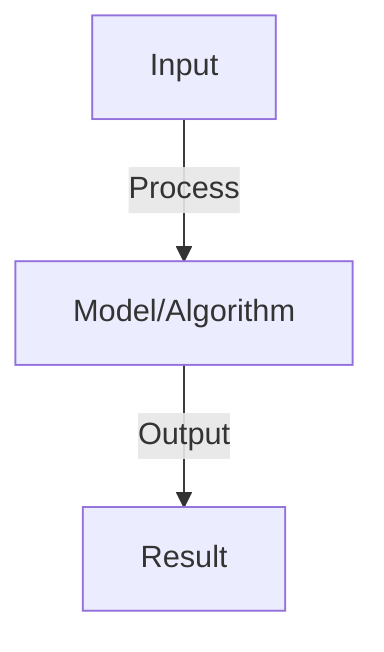

# Neural Architecture Search

NAS optimizes only within its search space and evaluation protocol, so the winning architecture is conditional on both.

## Prerequisites

Understand transformer inputs, tensor shapes, and how to evaluate a model on held-out data. This lesson narrows that background to the mechanism and decisions specific to neural architecture search.

## Learning Outcomes

- Explain the central mechanism and identify its key inputs and outputs.
- Compare at least two design choices using a quality measure and an operational cost.
- Diagnose a failure by selecting a workload slice and testing the assumption it violates.

## Core Intuition

Designing neural networks is like designing a building: you need decisions about number of floors (layers), room layouts (connections), and materials (activation functions). NAS is like having a robot architect that automatically designs buildings, testing thousands of variations until finding the best design for the requirements. Instead of relying on human architects, let automated search find good designs.

NAS optimizes only within its search space and evaluation protocol, so the winning architecture is conditional on both. A reliable design begins with a simple baseline and makes the specialized method earn its added complexity through measured improvement. Keep the evaluation split and serving constraints fixed so the comparison isolates the design decision.

## How It Works

1. Search space: define possible operations (layers, attention heads, dimensions)
2. Search strategy: random search, grid search, reinforcement learning, evolutionary algorithms
3. Reinforcement learning approach: controller network generates architectures
4. Evaluation: train architecture candidate, measure accuracy + latency
5. Reward: accuracy - λ * latency (trade-off between performance and efficiency)
6. Iterate: generate new architectures based on successful designs
7. Output: optimal architecture (AutoML)



Include latency and memory constraints in candidate selection, then retrain finalists from scratch on the full recipe. Compare alternatives at a fixed input distribution and record both quality and system cost. For image models, vary resolution and patch size; for fusion, vary which modalities are available; for security, exercise allowed and denied actions; for retrieval, separate candidate generation from ranking. These controls make it possible to tell whether a change fixes the intended bottleneck or only moves it.

A useful experiment includes a baseline, a changed condition, and a deliberately difficult case. Use deterministic synthetic examples first to validate logic, then a held-out realistic slice to estimate task impact. Report uncertainty or repeat runs when training randomness can change the result.

## Trade-offs

| Design | Benefit | Cost or risk | Decision signal |
|---|---|---|---|
| Unconstrained baseline | Keeps the largest set of interactions or evidence | Highest memory, compute, or input burden | Use while the workload fits and quality is the priority |
| Structured method | Bounds a specific resource or failure path | May exclude useful cases | Use when workload structure justifies the constraint |
| Learned or approximate method | Can adapt behavior to the task | Adds estimation error and tuning sensitivity | Require slice-level quality checks |
| Modular fallback | Limits blast radius and supports missing inputs | Adds routing or orchestration work | Use when inputs or permissions vary by request |

## Implementation

The following dependency-light check captures one invariant for the topic. It is a logic check, not a claim of end-to-end model performance.

```python
candidates = [8, 5, 11]
assert min(candidates) == 5
```

For a full experiment, keep a control implementation and record input shape, data split, model version, batch policy, hardware, and measurement method. Measure warm and steady-state latency separately where compilation or caching is involved. A measured result should state the exact workload and include quality; a microbenchmark cannot establish user-facing benefit by itself.

## Failure Modes

- Proxy ranking reverses after full training; retrain several finalists. Diagnose by logging the topic-specific signal and comparing it with the expected input contract.
- Validation data leaks into repeated search decisions; preserve a final test set. Build a targeted edge case and check whether the failure is systematic across a meaningful slice.
- FLOPs satisfy a constraint but device latency does not; profile the target hardware. Compare against the baseline and monitor the affected quality or tail-cost metric after rollout.

## Interview Quick Reference

| Question | Expected answer |
|---|---|
| What is the design’s central mechanism? | NAS optimizes only within its search space and evaluation protocol, so the winning architecture is conditional on both. Name its assumptions and the resource or behavior it changes. |
| What alternative would you evaluate? | Compare the unconstrained baseline with a structured or modular approach on the same task and budget. |
| How would you investigate a regression? | Slice the affected workload, test the violated assumption, and compare with a control path. |

**Debugging follow-up:** Proxy ranking reverses after full training; retrain several finalists. What would you log, what held-out case would you add, and which metric would trigger rollback?

## Related Concepts

Read [attention optimization](24-attention-optimization.md), [evaluation](32-evaluation.md), and the [associated notebook](../notebooks/38-neural-architecture-search.ipynb). Drill: [practice question](../interview-prep/curriculum-practice.md#neural-architecture-search).

References: [primary source](https://arxiv.org/abs/1802.01548); [technical reference](https://arxiv.org/abs/1611.01578).

### Existing interview notes

**Q: Why is NAS expensive and how do you reduce cost?**
A: NAS trains hundreds of models, each taking hours. Expensive because: full training per candidate. Reduce: (1) early stopping (train only 10 epochs), (2) weight sharing (reuse weights across architectures), (3) proxy tasks (smaller dataset), (4) Bayesian optimization (fewer candidates).

**Q: What are differentiable NAS and evolutionary NAS?**
A: Differentiable (DARTS): continuous relaxation of architecture search, gradient-based optimization. Fast (hours vs days). Evolutionary: mutation/crossover of architecture genes, population-based. Slower but more flexible. DARTS better for time-constrained, evolutionary more thorough.

**Q: Can NAS find good architectures for LLMs?**
A: Yes but expensive: LLM search space huge (embedding dim, heads, layers, hidden size). Cost: millions of GPU hours. Recent work: search for small LLMs (efficient architectures), search for adapters (not full models). Practical: use human-guided search (architect suggests promising configurations).

**Q: How do you avoid getting stuck in local optima in NAS?**
A: Use population-based methods (evolutionary), not greedy. Diversity: encourage exploration of different architecture families. Multi-objective: optimize for multiple metrics (accuracy, latency, memory) to escape single-objective local optima.

**Q: What is Bayesian optimization in NAS?**
A: Gaussian process models performance as function of architecture parameters. Iteratively: (1) sample next architecture (exploit high expected performance + explore uncertainty), (2) train + evaluate, (3) update model. Fewer evaluations than random search (10-100x speedup).
