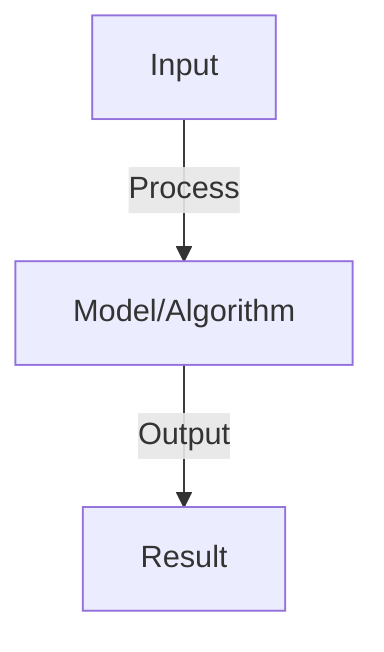

# Long-Context Handling

Long context increases available evidence but also raises attention cost and does not guarantee equal use of every position.

## Prerequisites

Understand transformer inputs, tensor shapes, and how to evaluate a model on held-out data. This lesson narrows that background to the mechanism and decisions specific to long-context handling.

## Learning Outcomes

- Explain the central mechanism and identify its key inputs and outputs.
- Compare at least two design choices using a quality measure and an operational cost.
- Diagnose a failure by selecting a workload slice and testing the assumption it violates.

## Core Intuition

A person can barely remember a 100-page document in detail but recalls key points and important sections. Transformers face similar challenge: remember everything takes too much brain power. Long context solutions work like humans: attend carefully to what matters (recent messages, relevant previous context), skim less important parts, or look up specific information when needed.

Long context increases available evidence but also raises attention cost and does not guarantee equal use of every position. A reliable design begins with a simple baseline and makes the specialized method earn its added complexity through measured improvement. Keep the evaluation split and serving constraints fixed so the comparison isolates the design decision.

## How It Works

1. Context window: max sequence length (GPT-4: 8K-128K, Llama: 4K-100K)
2. Challenge: transformers have O(n²) complexity, can't process unlimited length
3. Approaches:
   - Sliding window: process chunks, maintain state across chunks
   - Sparse attention: attend to every k-th token, reduce complexity to O(n log n)
   - Hierarchical: summarize chunks, attend to summaries not raw tokens
   - Retrieval-augmented: retrieve relevant chunks, don't process all
4. Long-context training: train on progressively longer sequences
5. Position interpolation: reuse position embeddings trained on shorter context



Evaluate evidence retrieval at beginning, middle, and end positions while varying distractors and context budget. Compare alternatives at a fixed input distribution and record both quality and system cost. For image models, vary resolution and patch size; for fusion, vary which modalities are available; for security, exercise allowed and denied actions; for retrieval, separate candidate generation from ranking. These controls make it possible to tell whether a change fixes the intended bottleneck or only moves it.

A useful experiment includes a baseline, a changed condition, and a deliberately difficult case. Use deterministic synthetic examples first to validate logic, then a held-out realistic slice to estimate task impact. Report uncertainty or repeat runs when training randomness can change the result.

## Trade-offs

| Design | Benefit | Cost or risk | Decision signal |
|---|---|---|---|
| Unconstrained baseline | Keeps the largest set of interactions or evidence | Highest memory, compute, or input burden | Use while the workload fits and quality is the priority |
| Structured method | Bounds a specific resource or failure path | May exclude useful cases | Use when workload structure justifies the constraint |
| Learned or approximate method | Can adapt behavior to the task | Adds estimation error and tuning sensitivity | Require slice-level quality checks |
| Modular fallback | Limits blast radius and supports missing inputs | Adds routing or orchestration work | Use when inputs or permissions vary by request |

## Implementation

The following dependency-light check captures one invariant for the topic. It is a logic check, not a claim of end-to-end model performance.

```python
limit, system, query, reserve = 1000, 100, 100, 200
assert limit-system-query-reserve == 600
```

For a full experiment, keep a control implementation and record input shape, data split, model version, batch policy, hardware, and measurement method. Measure warm and steady-state latency separately where compilation or caching is involved. A measured result should state the exact workload and include quality; a microbenchmark cannot establish user-facing benefit by itself.

## Failure Modes

- Evidence at the end is truncated; reserve output tokens and check truncation boundaries. Diagnose by logging the topic-specific signal and comparing it with the expected input contract.
- Needle retrieval falls in the middle; stratify accuracy by evidence location. Build a targeted edge case and check whether the failure is systematic across a meaningful slice.
- A large window replaces retrieval despite irrelevant context; compare equal token budgets. Compare against the baseline and monitor the affected quality or tail-cost metric after rollout.

## Interview Quick Reference

| Question | Expected answer |
|---|---|
| What is the design’s central mechanism? | Long context increases available evidence but also raises attention cost and does not guarantee equal use of every position. Name its assumptions and the resource or behavior it changes. |
| What alternative would you evaluate? | Compare the unconstrained baseline with a structured or modular approach on the same task and budget. |
| How would you investigate a regression? | Slice the affected workload, test the violated assumption, and compare with a control path. |

**Debugging follow-up:** Evidence at the end is truncated; reserve output tokens and check truncation boundaries. What would you log, what held-out case would you add, and which metric would trigger rollback?

## Related Concepts

Read [attention optimization](24-attention-optimization.md), [evaluation](32-evaluation.md), and the [associated notebook](../notebooks/39-long-context-handling.ipynb). Drill: [practice question](../interview-prep/curriculum-practice.md#long-context-handling).

References: [primary source](https://arxiv.org/abs/2307.03172); [technical reference](https://arxiv.org/abs/2308.14508).

### Existing interview notes

**Q: How do sliding window and recurrence help with long contexts?**
A: Sliding window: process document in chunks (2K-4K tokens), keep hidden state. Recurrence: pass compressed state to next chunk. Tradeoff: some information loss at chunk boundaries but enables processing of 100K+ documents.

**Q: What is ALiBi and position interpolation?**
A: ALiBi (Attention with Linear Biases): replace sinusoidal position embeddings with learnable relative position biases. Position interpolation: scale position embeddings to longer lengths. Both enable extending context beyond training length without retraining.

**Q: How does retrieval-augmented generation avoid long context limits?**
A: Instead of processing entire document, retrieve most relevant chunks (BM25 or dense retrieval). Process retrieved chunks (2K-4K) not full document. Enables effective use of very long documents (100K+) with standard context windows.

**Q: What is the cost of processing long contexts?**
A: O(n²) for standard attention: 2x context = 4x compute. Sparse/hierarchical reduce to O(n log n). Cost tradeoff: faster inference but lower quality (may miss relevant distant context). Measure on task performance.

**Q: Can you extend any model to longer context?**
A: Partially: ALiBi and position interpolation work on many models. Challenge: model may not have seen long sequences in training, learns to ignore distant tokens. Better: models trained on long context from start (Llama 2 100K, GPT-4 128K). Fine-tuning helps but expensive.
