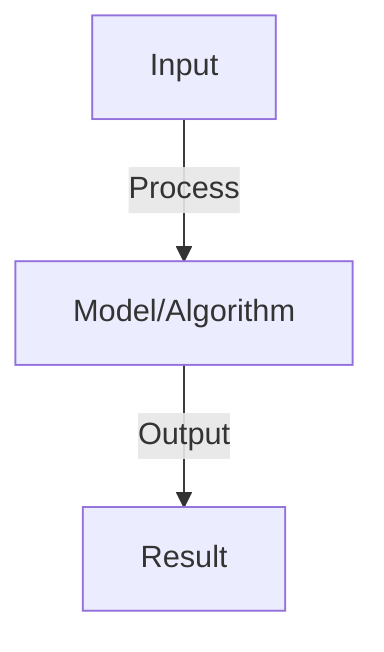

# Retrieval Systems

A reranker can reorder retrieved candidates but cannot recover a relevant document that candidate generation omitted.

## Prerequisites

Understand transformer inputs, tensor shapes, and how to evaluate a model on held-out data. This lesson narrows that background to the mechanism and decisions specific to retrieval systems.

## Learning Outcomes

- Explain the central mechanism and identify its key inputs and outputs.
- Compare at least two design choices using a quality measure and an operational cost.
- Diagnose a failure by selecting a workload slice and testing the assumption it violates.

## Core Intuition

When answering a question about current events, you don't have that knowledge in your head. Instead, you'd search for articles, read them, then answer the question based on what you found. Retrieval systems work exactly this way: they find relevant documents, the language model reads them, and generates an answer. This separates knowledge storage (documents) from reasoning (language model).

A reranker can reorder retrieved candidates but cannot recover a relevant document that candidate generation omitted. A reliable design begins with a simple baseline and makes the specialized method earn its added complexity through measured improvement. Keep the evaluation split and serving constraints fixed so the comparison isolates the design decision.

## How It Works

1. Query: user question or task
2. Retrieval: find most relevant documents
   - Sparse retrieval: BM25 (keyword matching, TF-IDF), fast but limited semantic understanding
   - Dense retrieval: embed query and documents, cosine similarity, slower but semantic
3. Ranking: re-rank top candidates with more sophisticated model
4. Indexing: store document embeddings in vector database (Pinecone, Weaviate, Milvus)
5. Pipeline: query embedding → vector search → dense ranking → return top-k
6. Evaluation: recall@k (was right doc in top-k?), MRR (rank of first relevant doc)



Measure candidate recall before ranking and nDCG after ranking; separately test freshness and authorization filters. Compare alternatives at a fixed input distribution and record both quality and system cost. For image models, vary resolution and patch size; for fusion, vary which modalities are available; for security, exercise allowed and denied actions; for retrieval, separate candidate generation from ranking. These controls make it possible to tell whether a change fixes the intended bottleneck or only moves it.

A useful experiment includes a baseline, a changed condition, and a deliberately difficult case. Use deterministic synthetic examples first to validate logic, then a held-out realistic slice to estimate task impact. Report uncertainty or repeat runs when training randomness can change the result.

## Trade-offs

| Design | Benefit | Cost or risk | Decision signal |
|---|---|---|---|
| Unconstrained baseline | Keeps the largest set of interactions or evidence | Highest memory, compute, or input burden | Use while the workload fits and quality is the priority |
| Structured method | Bounds a specific resource or failure path | May exclude useful cases | Use when workload structure justifies the constraint |
| Learned or approximate method | Can adapt behavior to the task | Adds estimation error and tuning sensitivity | Require slice-level quality checks |
| Modular fallback | Limits blast radius and supports missing inputs | Adds routing or orchestration work | Use when inputs or permissions vary by request |

## Implementation

The following dependency-light check captures one invariant for the topic. It is a logic check, not a claim of end-to-end model performance.

```python
relevant, retrieved = {"a","b"}, ["x","a","b"]
assert len(relevant & set(retrieved[:3])) == 2
```

For a full experiment, keep a control implementation and record input shape, data split, model version, batch policy, hardware, and measurement method. Measure warm and steady-state latency separately where compilation or caching is involved. A measured result should state the exact workload and include quality; a microbenchmark cannot establish user-facing benefit by itself.

## Failure Modes

- Candidate recall is low; inspect query and corpus slices before tuning reranking. Diagnose by logging the topic-specific signal and comparing it with the expected input contract.
- Stale records remain in the index; test update and deletion propagation. Build a targeted edge case and check whether the failure is systematic across a meaningful slice.
- Authorization is checked after retrieval; enforce filters before text is exposed downstream. Compare against the baseline and monitor the affected quality or tail-cost metric after rollout.

## Interview Quick Reference

| Question | Expected answer |
|---|---|
| What is the design’s central mechanism? | A reranker can reorder retrieved candidates but cannot recover a relevant document that candidate generation omitted. Name its assumptions and the resource or behavior it changes. |
| What alternative would you evaluate? | Compare the unconstrained baseline with a structured or modular approach on the same task and budget. |
| How would you investigate a regression? | Slice the affected workload, test the violated assumption, and compare with a control path. |

**Debugging follow-up:** Candidate recall is low; inspect query and corpus slices before tuning reranking. What would you log, what held-out case would you add, and which metric would trigger rollback?

## Related Concepts

Read [attention optimization](24-attention-optimization.md), [evaluation](32-evaluation.md), and the [associated notebook](../notebooks/40-retrieval-systems.ipynb). Drill: [practice question](../interview-prep/curriculum-practice.md#retrieval-systems).

References: [primary source](https://arxiv.org/abs/2104.08663); [technical reference](https://www.elastic.co/guide/en/elasticsearch/reference/current/rrf.html).

### Existing interview notes

**Q: When should you use BM25 vs dense retrieval?**
A: BM25: exact keyword matches, fast, works for domain with jargon. Dense: semantic understanding, slow, works across paraphrases. Hybrid: BM25 initial retrieval (100 candidates) + dense re-ranking. Typical: dense + sparse together.

**Q: What is vector quantization and why does it matter?**
A: VQ: compress embeddings (8-bit instead of 32-bit). Reduces storage (4x) and speeds search (fewer bytes to compare). Tradeoff: small accuracy loss (typically <1%). Essential for very large indexes (billions of documents).

**Q: How do you handle out-of-domain queries in retrieval?**
A: Challenge: model trained on domain A, query from domain B. Solutions: (1) fine-tune on target domain, (2) ensemble multiple retrievers, (3) use universal embeddings (trained on many domains), (4) detect out-of-domain and alert user.

**Q: What is the difference between retrieval and re-ranking?**
A: Retrieval: fast, retrieve 100-1000 candidates (recall focused). Re-ranking: slower, reorder top candidates with expensive model (precision focused). Together: get high recall + high precision. Typical: BM25 retrieval + dense re-ranking.

**Q: How do you evaluate retrieval quality?**
A: Metrics: recall@k (relevant doc in top-k?), NDCG (position of relevant docs matter), MRR (rank of first), precision@k (% of top-k relevant). Task matters: sometimes recall@1 critical, sometimes need top-10 for diversity.
