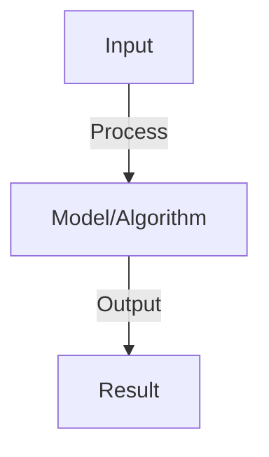

# Model Editing

A model edit should change a target fact while preserving paraphrase behavior and unrelated knowledge.

## Prerequisites

Understand transformer inputs, tensor shapes, and how to evaluate a model on held-out data. This lesson narrows that background to the mechanism and decisions specific to model editing.

## Learning Outcomes

- Explain the central mechanism and identify its key inputs and outputs.
- Compare at least two design choices using a quality measure and an operational cost.
- Diagnose a failure by selecting a workload slice and testing the assumption it violates.

## Core Intuition

If you were a giant library and someone discovered we got one historical date wrong, you'd want to fix just that one piece of knowledge rather than reorganize the entire library. Model editing is like precision surgery: instead of rebuilding the model, we reach in and fix specific wrong knowledge, hopefully without breaking anything else.

A model edit should change a target fact while preserving paraphrase behavior and unrelated knowledge. A reliable design begins with a simple baseline and makes the specialized method earn its added complexity through measured improvement. Keep the evaluation split and serving constraints fixed so the comparison isolates the design decision.

## How It Works

1. Problem: model learned incorrect fact, wants to update without full retraining
2. Approach: rank-one model editing (ROME), modify specific neuron activations
3. ROME: identify neurons storing fact, update their weights slightly
4. Process:
   - Locate fact: find layer and neurons responding to query
   - Compute update: gradient to maximize correct answer
   - Apply: update weights in target neurons only
5. Alternative: in-context editing (provide correct info in prompt, model learns from context)
6. Evaluation: does edit work? Does it break other facts? How stable?



Measure target success, paraphrase generalization, locality, and retention before and after each edit. Compare alternatives at a fixed input distribution and record both quality and system cost. For image models, vary resolution and patch size; for fusion, vary which modalities are available; for security, exercise allowed and denied actions; for retrieval, separate candidate generation from ranking. These controls make it possible to tell whether a change fixes the intended bottleneck or only moves it.

A useful experiment includes a baseline, a changed condition, and a deliberately difficult case. Use deterministic synthetic examples first to validate logic, then a held-out realistic slice to estimate task impact. Report uncertainty or repeat runs when training randomness can change the result.

## Trade-offs

| Design | Benefit | Cost or risk | Decision signal |
|---|---|---|---|
| Unconstrained baseline | Keeps the largest set of interactions or evidence | Highest memory, compute, or input burden | Use while the workload fits and quality is the priority |
| Structured method | Bounds a specific resource or failure path | May exclude useful cases | Use when workload structure justifies the constraint |
| Learned or approximate method | Can adapt behavior to the task | Adds estimation error and tuning sensitivity | Require slice-level quality checks |
| Modular fallback | Limits blast radius and supports missing inputs | Adds routing or orchestration work | Use when inputs or permissions vary by request |

## Implementation

The following dependency-light check captures one invariant for the topic. It is a logic check, not a claim of end-to-end model performance.

```python
before, after, desired = "old", "new", "new"
assert after == desired and before != desired
```

For a full experiment, keep a control implementation and record input shape, data split, model version, batch policy, hardware, and measurement method. Measure warm and steady-state latency separately where compilation or caching is involved. A measured result should state the exact workload and include quality; a microbenchmark cannot establish user-facing benefit by itself.

## Failure Modes

- Target wording changes but paraphrases do not; include paraphrase probes. Diagnose by logging the topic-specific signal and comparing it with the expected input contract.
- Unrelated answers drift; measure locality on control prompts. Build a targeted edge case and check whether the failure is systematic across a meaningful slice.
- Evaluation repeats only the edit prompt; use held-out formulations. Compare against the baseline and monitor the affected quality or tail-cost metric after rollout.

## Interview Quick Reference

| Question | Expected answer |
|---|---|
| What is the design’s central mechanism? | A model edit should change a target fact while preserving paraphrase behavior and unrelated knowledge. Name its assumptions and the resource or behavior it changes. |
| What alternative would you evaluate? | Compare the unconstrained baseline with a structured or modular approach on the same task and budget. |
| How would you investigate a regression? | Slice the affected workload, test the violated assumption, and compare with a control path. |

**Debugging follow-up:** Target wording changes but paraphrases do not; include paraphrase probes. What would you log, what held-out case would you add, and which metric would trigger rollback?

## Related Concepts

Read [attention optimization](24-attention-optimization.md), [evaluation](32-evaluation.md), and the [associated notebook](../notebooks/42-model-editing.ipynb). Drill: [practice question](../interview-prep/curriculum-practice.md#model-editing).

References: [primary source](https://arxiv.org/abs/2202.05262); [technical reference](https://rome.baulab.info/).

### Existing interview notes

**Q: Why is model editing useful vs retraining?**
A: Retraining: expensive (hours/days, requires data). Editing: seconds, no data needed. Tradeoff: editing updates local facts, retraining updates model comprehensively. Edit for small corrections (fix typo in training data), retrain for systematic improvements.

**Q: How do you know which neurons store which facts?**
A: Mechanistic interpretability: trace information flow (activations at each layer). Identify layers/neurons that change when querying fact. Use probing classifiers: train small classifier on neuron activations, predicts fact value. Works surprisingly well.

**Q: Can you edit multiple facts without conflicts?**
A: Sequential editing: edit fact A, then fact B. Risk: fact B edit interferes with fact A update (write conflicts). Mitigations: (1) choose disjoint neurons, (2) detect conflicts and resolve, (3) joint editing (update multiple neurons simultaneously).

**Q: What is in-context editing and how does it differ from weight editing?**
A: In-context: include correct fact in prompt (context learning). Weight editing: modify model weights. In-context: temporary (only for this inference), no permanent change. Weight: persistent. Combined: in-context for quick fixes, weight for permanent updates.

**Q: How do you evaluate editing?**
A: Metrics: (1) target accuracy (does edit work?), (2) side effect (other facts broken?), (3) generalization (does it generalize to paraphrases?). Ideal: high target accuracy, low side effects, high generalization.
