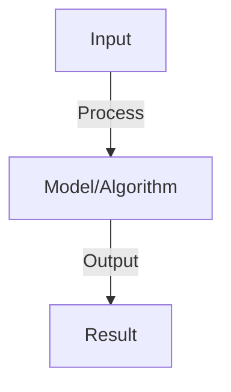

# Mixture of Experts (MoE)

Sparse MoE routing activates only selected experts per token but can bottleneck on overloaded experts and cross-device communication.

## Prerequisites

Understand transformer inputs, tensor shapes, and how to evaluate a model on held-out data. This lesson narrows that background to the mechanism and decisions specific to mixture of experts (moe).

## Learning Outcomes

- Explain the central mechanism and identify its key inputs and outputs.
- Compare at least two design choices using a quality measure and an operational cost.
- Diagnose a failure by selecting a workload slice and testing the assumption it violates.

## Core Intuition

A hospital has many specialists: cardiologists, neurologists, surgeons. When a patient arrives, a triage nurse routes them to the appropriate specialist. You don't need every specialist to examine every patient—just the relevant expert. Mixture of Experts works similarly: input data gets routed to specialized network 'experts' that are most relevant, saving computation.

Sparse MoE routing activates only selected experts per token but can bottleneck on overloaded experts and cross-device communication. A reliable design begins with a simple baseline and makes the specialized method earn its added complexity through measured improvement. Keep the evaluation split and serving constraints fixed so the comparison isolates the design decision.

## How It Works

1. Expert networks: partition model into experts (separate networks)
2. Router network: decides which experts to use for each token
3. Process: token → router → select top-k experts → combine outputs
4. Advantages: activate only k of e experts (if e=8, k=2 → 75% params inactive)
5. Training: router learns what task each expert should specialize in
6. Load balancing: encourage router to use all experts evenly
7. Example: Switch Transformer (1.6T params, efficient), GPTQ-MoE variants



Track top-k assignments, expert utilization, capacity overflow, and quality together under a fixed token batch. Compare alternatives at a fixed input distribution and record both quality and system cost. For image models, vary resolution and patch size; for fusion, vary which modalities are available; for security, exercise allowed and denied actions; for retrieval, separate candidate generation from ranking. These controls make it possible to tell whether a change fixes the intended bottleneck or only moves it.

A useful experiment includes a baseline, a changed condition, and a deliberately difficult case. Use deterministic synthetic examples first to validate logic, then a held-out realistic slice to estimate task impact. Report uncertainty or repeat runs when training randomness can change the result.

## Trade-offs

| Design | Benefit | Cost or risk | Decision signal |
|---|---|---|---|
| Unconstrained baseline | Keeps the largest set of interactions or evidence | Highest memory, compute, or input burden | Use while the workload fits and quality is the priority |
| Structured method | Bounds a specific resource or failure path | May exclude useful cases | Use when workload structure justifies the constraint |
| Learned or approximate method | Can adapt behavior to the task | Adds estimation error and tuning sensitivity | Require slice-level quality checks |
| Modular fallback | Limits blast radius and supports missing inputs | Adds routing or orchestration work | Use when inputs or permissions vary by request |

## Implementation

The following dependency-light check captures one invariant for the topic. It is a logic check, not a claim of end-to-end model performance.

```python
scores = [0.1, 0.8, 0.4]
assert sorted(range(3), key=lambda i: scores[i], reverse=True)[:2] == [1,2]
```

For a full experiment, keep a control implementation and record input shape, data split, model version, batch policy, hardware, and measurement method. Measure warm and steady-state latency separately where compilation or caching is involved. A measured result should state the exact workload and include quality; a microbenchmark cannot establish user-facing benefit by itself.

## Failure Modes

- Routing concentrates tokens on a few experts; inspect the utilization histogram. Diagnose by logging the topic-specific signal and comparing it with the expected input contract.
- Capacity overflow drops tokens; measure dropped-token rate at peak load. Build a targeted edge case and check whether the failure is systematic across a meaningful slice.
- All-to-all communication erases compute savings; profile across realistic device topology. Compare against the baseline and monitor the affected quality or tail-cost metric after rollout.

## Interview Quick Reference

| Question | Expected answer |
|---|---|
| What is the design’s central mechanism? | Sparse MoE routing activates only selected experts per token but can bottleneck on overloaded experts and cross-device communication. Name its assumptions and the resource or behavior it changes. |
| What alternative would you evaluate? | Compare the unconstrained baseline with a structured or modular approach on the same task and budget. |
| How would you investigate a regression? | Slice the affected workload, test the violated assumption, and compare with a control path. |

**Debugging follow-up:** Routing concentrates tokens on a few experts; inspect the utilization histogram. What would you log, what held-out case would you add, and which metric would trigger rollback?

## Related Concepts

Read [attention optimization](24-attention-optimization.md), [evaluation](32-evaluation.md), and the [associated notebook](../notebooks/43-mixture-of-experts.ipynb). Drill: [practice question](../interview-prep/curriculum-practice.md#mixture-of-experts-moe).

References: [primary source](https://arxiv.org/abs/1701.06538); [technical reference](https://arxiv.org/abs/2101.03961).

### Existing interview notes

**Q: How does MoE reduce inference cost?**
A: Selective activation: if 128 experts but use 2, only compute for 2 experts. O(param_count / num_experts) speedup. Example: 1T model with 8 experts, use 2 → 14x speedup vs full model. Tradeoff: need specialized routing.

**Q: What is load balancing in MoE and why is it needed?**
A: Problem: router might overuse 1-2 experts (ignore others). Load balancing loss: penalizes imbalanced selection, encourages uniform usage. Why: unused experts waste capacity, load concentration causes bottlenecks.

**Q: How do you train the router network?**
A: Router: small network (1-2 layers) outputting logits over experts. Trained jointly with experts. Loss: task loss + load balance loss. Router learns through gradient descent which experts are useful for which inputs.

**Q: What is sparse MoE vs dense MoE?**
A: Sparse: each input uses small subset of experts (k=2 of 128). Dense: each input uses all experts (weighted, not sparse). Sparse much more efficient, denser slightly higher quality. Typical: sparse MoE for large models.

**Q: How do you handle MoE in distributed training?**
A: Challenge: experts might be unbalanced across devices (some devices compute more). Solution: (1) expert parallelism (distribute experts across devices), (2) dynamic load balancing (move computation to balance load), (3) auxiliary loss to encourage balanced expert usage.
