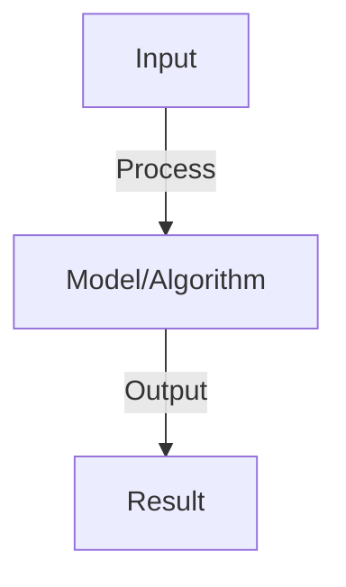

# Efficient Attention

FlashAttention reduces memory traffic while computing exact attention; sparse and linear variants also change which interactions are computed.

## Prerequisites

Understand transformer inputs, tensor shapes, and how to evaluate a model on held-out data. This lesson narrows that background to the mechanism and decisions specific to efficient attention.

## Learning Outcomes

- Explain the central mechanism and identify its key inputs and outputs.
- Compare at least two design choices using a quality measure and an operational cost.
- Diagnose a failure by selecting a workload slice and testing the assumption it violates.

## Core Intuition

Standard attention is like having a person remember every detail they've ever heard about the topic, comparing current input to every past fact. That's exhausting for long memories. Efficient attention is like having a person remember key facts and recent context, quickly skipping irrelevant details. Different efficient methods skip details differently—some remember recency, others remember importance, others remember specific structural patterns.

FlashAttention reduces memory traffic while computing exact attention; sparse and linear variants also change which interactions are computed. A reliable design begins with a simple baseline and makes the specialized method earn its added complexity through measured improvement. Keep the evaluation split and serving constraints fixed so the comparison isolates the design decision.

## How It Works

1. Standard attention: compute attention over all n tokens, O(n²) complexity
2. Bottleneck: long sequences intractable (2K context = 4M attention scores)
3. Efficient approaches:
   - Sparse attention: attend to local neighbors + random sampled tokens (BigBird, Longformer)
   - Low-rank: decompose attention matrix into lower-rank factors
   - Linear attention: use kernel trick, O(n) complexity
   - Flash Attention: hardware-aware, same complexity but much faster (4x speedup)
4. Implementation: choose based on sequence length and available hardware



Separate attention arithmetic from memory traffic and compare full, local, and tiled methods at the same sequence lengths. Compare alternatives at a fixed input distribution and record both quality and system cost. For image models, vary resolution and patch size; for fusion, vary which modalities are available; for security, exercise allowed and denied actions; for retrieval, separate candidate generation from ranking. These controls make it possible to tell whether a change fixes the intended bottleneck or only moves it.

A useful experiment includes a baseline, a changed condition, and a deliberately difficult case. Use deterministic synthetic examples first to validate logic, then a held-out realistic slice to estimate task impact. Report uncertainty or repeat runs when training randomness can change the result.

## Trade-offs

| Design | Benefit | Cost or risk | Decision signal |
|---|---|---|---|
| Unconstrained baseline | Keeps the largest set of interactions or evidence | Highest memory, compute, or input burden | Use while the workload fits and quality is the priority |
| Structured method | Bounds a specific resource or failure path | May exclude useful cases | Use when workload structure justifies the constraint |
| Learned or approximate method | Can adapt behavior to the task | Adds estimation error and tuning sensitivity | Require slice-level quality checks |
| Modular fallback | Limits blast radius and supports missing inputs | Adds routing or orchestration work | Use when inputs or permissions vary by request |

## Implementation

The following dependency-light check captures one invariant for the topic. It is a logic check, not a claim of end-to-end model performance.

```python
n, window = 1000, 64
assert n*window < n*n
```

For a full experiment, keep a control implementation and record input shape, data split, model version, batch policy, hardware, and measurement method. Measure warm and steady-state latency separately where compilation or caching is involved. A measured result should state the exact workload and include quality; a microbenchmark cannot establish user-facing benefit by itself.

## Failure Modes

- Local window misses a distant dependency; test long-range retrieval tasks. Diagnose by logging the topic-specific signal and comparing it with the expected input contract.
- Approximation lowers task quality; compare against exact attention on a representative slice. Build a targeted edge case and check whether the failure is systematic across a meaningful slice.
- Memory bandwidth improvement is reported as a reduction in quadratic arithmetic; state the distinction. Compare against the baseline and monitor the affected quality or tail-cost metric after rollout.

## Interview Quick Reference

| Question | Expected answer |
|---|---|
| What is the design’s central mechanism? | FlashAttention reduces memory traffic while computing exact attention; sparse and linear variants also change which interactions are computed. Name its assumptions and the resource or behavior it changes. |
| What alternative would you evaluate? | Compare the unconstrained baseline with a structured or modular approach on the same task and budget. |
| How would you investigate a regression? | Slice the affected workload, test the violated assumption, and compare with a control path. |

**Debugging follow-up:** Local window misses a distant dependency; test long-range retrieval tasks. What would you log, what held-out case would you add, and which metric would trigger rollback?

## Related Concepts

Read [attention optimization](24-attention-optimization.md), [evaluation](32-evaluation.md), and the [associated notebook](../notebooks/44-efficient-attention.ipynb). Drill: [practice question](../interview-prep/curriculum-practice.md#efficient-attention).

References: [primary source](https://arxiv.org/abs/2205.14135); [technical reference](https://arxiv.org/abs/2307.08691).

### Existing interview notes

**Q: What is Flash Attention and why is it so fast?**
A: Flash Attention: I/O aware algorithm, reduces memory access (main bottleneck). Groups computation to fit in GPU cache. Mathematically same result as standard attention but 4-10x faster in practice. No approximation, just better implementation.

**Q: How do sparse attention patterns work?**
A: Idea: don't attend to all tokens, only subset. Patterns: (1) local (attend to neighbors), (2) strided (attend to every k-th token), (3) random (attend to random subset). Reduces complexity to O(n log n). Slight accuracy loss but enables longer sequences.

**Q: What is linear attention and how does it work?**
A: Linear attention: replace softmax with kernel function (e.g., elu+1). Enables O(n) complexity using associativity: (QK^T)V = Q(K^T V). Tradeoff: lower quality than softmax, but much faster for very long sequences.

**Q: How do you choose between sparse and linear attention?**
A: Sparse: better accuracy (closer to full attention), moderate speedup (2-4x). Linear: fast (10x+) but lower quality. Choose based on: priority (accuracy vs speed), sequence length (sparse for 8K, linear for 100K+), domain (recurrent tasks tolerate approximation).

**Q: Can you combine efficient attention with long-context training?**
A: Yes, combine for best results: (1) efficient attention (Flash/sparse) during training, (2) position interpolation for longer context, (3) train on progressively longer sequences. Enables training on very long context (100K+) with reasonable compute.
